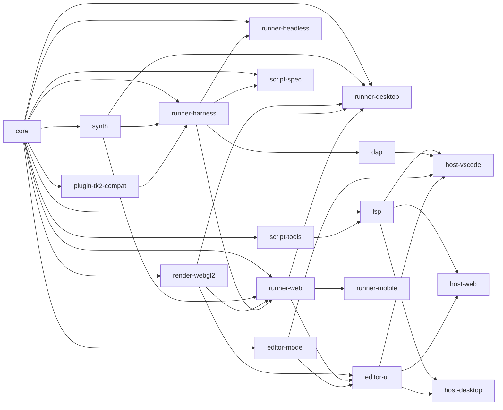
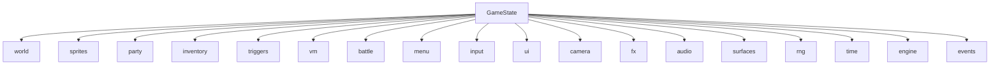
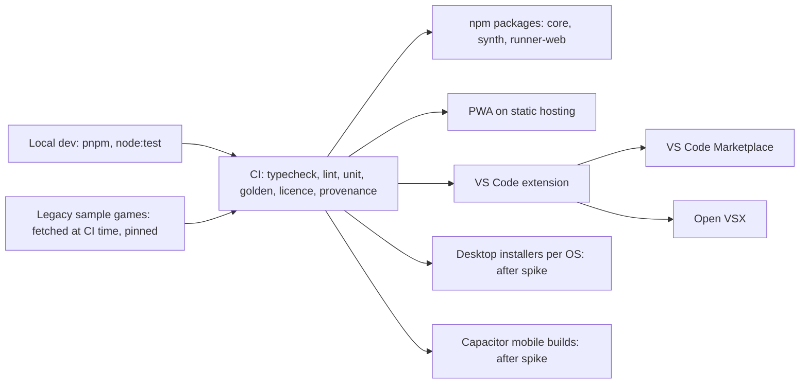

# Architecture Spine — rpgtoolkit-reawakened

## Design Paradigm

Hexagonal. The **core** is a pure, deterministic simulation: bytes and input events in; state, draw lists, audio cues and requests out. Every platform thing (display, sound, devices, files, editor host) is an **adapter** behind a port the core or the editor defines. The core is tick-driven, never event-driven or async.

| Layer | Package | Role |
| --- | --- | --- |
| Domain | `core` | formats, resolver, image and font decoding, world, sprites, triggers, script VM, battle, menu, save, tick pipeline, draw-list and cue builders, reference rasteriser |
| Ports | `core/ports` | service interfaces for the VM and domain modules; the runner-facing engine API |
| Driving adapters | `runner-*`, `lsp`, `dap`, `editor-ui` | call the core |
| Driven adapters | `synth`, `render-webgl2`, asset sources | realise cues, draw lists and asset requests |
| Editor model | `editor-model` | DOM-free documents and command stacks |
| Hosts | `host-*` | platform-services and chrome only |

One checked-in edge list (`tools/deps/edges.json`) generates this graph and the dependency-cruiser rules (AD-22). An arrow means "may be depended on by". Same-tier imports are allowed only where an arrow is drawn.



## Inherited Invariants

Parent: [ADR 0001](../../../docs/adr/0001-typescript-core.md) and [guardrails.md](../../../docs/guardrails.md). Read-only here. Where an AD extends a guard-rail's enforcement, it says so and is listed under ADR 0002 in Deferred.

| Inherited | From parent | Binds here |
| --- | --- | --- |
| G1 step-machine VM, plain-data state | guardrails | AD-7 to AD-10, AD-26 |
| G2 package boundaries, platform-services only | guardrails | AD-1, AD-6, AD-20, AD-22 |
| G3 determinism: injected clock and RNG, fixed tick | guardrails | AD-2, AD-5, AD-11 to AD-14, AD-25, AD-26 |
| G4 renderers only replay draw lists | guardrails | AD-3, AD-4, AD-27 |
| G5 headless goldens required | guardrails | AD-11, AD-14 make hashes and logs the test substrate |
| G6 licence test (Blue Oak Bronze or better, minus MS-PL; ADR 0003) | guardrails | Stack; Deferred names the `ovsx` exemption |
| G7 clean-room | guardrails | every AD cites doc sections, never legacy source |
| TypeScript everywhere; VS Code and standalone hosts first-class | ADR 0001 | Stack, AD-19, AD-20 |
| Script lowering, plugin command registry, deterministic event bus | ADR 0004 | AD-8, AD-31, AD-32, AD-33 |

## Invariants & Rules

### AD-1 — One engine API: advance, drawList

- **Binds:** CAP-2, CAP-3, CAP-4, CAP-5, CAP-6, CAP-8, CAP-12, CAP-13, CAP-14
- **Prevents:** runners and tests driving the core differently; replays that depend on how a runner batches ticks; mid-tick debug states.
- **Rule:** `createEngine(init)` returns `Engine`. `advance(ticks, inputs: { tick, event }[]) -> TickReport` runs whole fixed ticks. A `maxTicks` cap bounds catch-up. `TickReport` carries `ticksRun`, `tickAfter`, `consumed` (the canonical input log, written by the core), audio cues, requests, diagnostics, `loading`, and `paused`. `drawList(alpha?) -> DrawList` is a pure function of current state; `alpha` is 0 in tests. `engine.surfacePixels(id, rev)` is the pixel accessor (AD-27). `engine.setBreakpoints(bps)` takes data; a hit stops mid-tick and returns `paused { thread, frame, line }`, with the open-tick cursor stored in `GameState` so it snapshots; debug hooks read state and never write it. Every argument and result is structured-cloneable plain data, so the core runs in a Worker. Outputs never alias state: every emitted `Uint8Array` owns its whole buffer (`byteOffset` 0) and is a copy; a host may transfer a buffer only when the core marks it handed off.
- **Reawakened rule (OWNER; breakpoint cursor).** With breakpoints installed, `advance` stores a plain-data open-tick cursor containing the ready-thread-list snapshot, current thread and steps used. A breakpoint returns `paused { thread, frame, line }`; `continue` finishes that open tick before later ticks, `step` executes one instruction and pauses again, and snapshots at the stop resume to the uninterrupted hash. `ticksRun` counts completed ticks only.
- **Reawakened rule (OWNER, 2026-10-31; `debugView()`).** The engine gains one read-only projection for debuggers, `debugView()`, returning plain data: the tick, per thread its id, kind, status, wait and frames (outermost to innermost, each with the program reference, instruction pointer, source line and function name), the innermost frame's locals and the global table. The view is copied out and never aliases the live frames or tables, so mutating it cannot change the VM and a call leaves the state hash unchanged. It is the only seam a debug adapter reads; step over, in and out are computed by the adapter from the frame depth between one-instruction resumes, so the engine gains no stepping mode beyond the breakpoint cursor above. The contract is [docs/spec/engine/rpgcode-tooling.md](../../../docs/spec/engine/rpgcode-tooling.md#tool-8).
- **Check:** type-checked API; a Worker contract test that transfers and mutates every returned buffer and asserts `stateHash` unchanged; a replay test that batches the same input log with different `ticks` per call.

### AD-2 — Time is the tick counter

- **Binds:** CAP-2, CAP-3, CAP-4, CAP-9, CAP-11
- **Prevents:** wall-clock or frame-rate leaking into state; animation phases rounded differently per epic.
- **Rule:** the simulation tick is fixed at 60 Hz. The injected clock of G3.1 **is** the tick counter supplied through `advance`; `getTickCount` and `gameTime = ticks / 60` derive from it. `core/time` alone owns `secondsToTicks`, `fpsToTicks` and `frameAt(originTick, tick, ticksPerFrame, count, loop)`; animated tiles use origin 0. The 60 Hz tick is kept as an assumption; the seconds-to-ticks rounding is ruled in `docs/spec/engine/rpgcode-runtime.md`.
- **Check:** lint bans `Date` and `performance` in `core` (G3); only `core/time` may convert seconds or fps to ticks.

### AD-3 — Draw list: flat, ordered, plain-data, integer pixels

- **Binds:** CAP-6, CAP-12, CAP-13, CAP-15
- **Prevents:** runners interpreting scenes differently; renderers holding state (G4); unhashable frames; tint and blend results differing between replayers.
- **Rule:** a `DrawList` is `{ tick, width, height, commands[] }` rebuilt per frame, with no deltas. `core/ports` publishes one `DrawCommand` union: `blit`, `fill`, `line`, `rect`, `ellipse`, `text`, `pushTarget`, `popTarget`. Types: `Rgb = { r, g, b }` integers 0–255; coordinates are integers in logical-resolution pixels; rectangles are `x, y, w, h`, half-open; `filled: boolean`; lines are 1 px with inclusive endpoints; ellipses are given by bounding box. A texture is a `TexRef = { asset: AssetKey, tile: number | null }` with `tile` 1-based (`null` means no tile; `docs/spec/formats/README.md#tile-references`). `.tan` and `.tbm` never cross the seam: the builder resolves them to tile `TexRef`s plus per-cell tint. `blit` carries `src` and `dst` integer rectangles, `key`, `tint`, `alpha` 0–255, `blend` (`normal` | `additive` | `translucent`) and an `iso2d` projection flag, with nearest-neighbour sampling. A blit source is a `TexRef` or a persistent surface `{ surface, rev }` (AD-27). `text` carries a `FontRef` and per-glyph advances (AD-15). The core draws the mouse cursor as the last command. Runners replay top to bottom and may cache, but discarding a cache changes nothing observable.
- **Reawakened rule (OWNER; FontRef and draw inputs).** `text` carries `FontRef = { asset, size, bold, italic }`; underline is a separate `line` command. Sprite order uses `(layer, projected screen-space reference-point y, drawId)`, with stable players-before-items category indices. `alpha` is presentation-only and excluded from state and draw hashes.
- **Pixel pipeline (normative, in `core/raster`):** (1) skip a pixel that is format-transparent or equals `key`, tested on the untinted source; (2) `c = clamp(src + tint, 0, 255)` once, where `tint` is the full pre-summed shade, board and global ambient offset (range ±1020, `docs/spec/formats/board.md#tile-shading`); (3) blend: `normal` → `c`; `translucent` → `(dst·(255−a) + c·a + 127) / 255`; `additive` → `min(255, dst + (c·a + 127) / 255)`, integer division; `percentToAlpha(p) = (p·255 + 50) / 100`.
- **Check:** one exported union; a lint rule that tint is computed only in `core/render/shade.ts`; per-command CPU-vs-WebGL2 conformance fixtures with exact match for key and tint.

### AD-4 — One reference rasteriser, in core

- **Binds:** CAP-5, CAP-6, CAP-13, CAP-16
- **Prevents:** script-visible pixels depending on the runner; two rasterisers drifting.
- **Rule:** `core/raster` is the single reference rasteriser, pure and I/O-free. It turns a `DrawList` plus surfaces into a bitmap and serves `canvasGetScreen`, `getPixel` and screen save and restore (E-56, E-58). `runner-harness` uses it for goldens and the editor uses it for image export. It amends `architecture-options.md` §2 ("no pixels in the core") and G4 rule 1's wording; see ADR 0002.
- **Check:** CPU-vs-WebGL2 agreement test in CI; `runner-*` import no rasteriser internals (AD-22).

### AD-5 — Assets and requests: blocking or stream, always replied by an input

- **Binds:** CAP-1, CAP-2, CAP-7, CAP-11, CAP-12, CAP-15
- **Prevents:** asset or file latency changing simulation results; per-runner path handling; requests with no way back into the core.
- **Rule:** the runner gives the core an `AssetIndex` (list of relative paths) at start. The shared resolver maps a logical path to a canonical `AssetKey` with an **ASCII-only case fold** (`A`–`Z` to `a`–`z`, every other code point unchanged; the rule and its reason are format-spec §1.5), `/` separators, the type-folder prefix rules of format-spec §1.5, and `projectPath` ignored inside a package. The fold is written out, never `String.prototype.toLowerCase`, because a full-Unicode fold follows the engine's Unicode tables (G3 wants one answer on every runner), merges `U+212A` with ASCII `k` where the legacy upper-case fold kept them apart, and turns `U+0130` into two code points; the former `[ASSUMPTION: ASCII-only case fold]` therefore becomes a ruling, not an assumption. Every request carries a core-assigned `reqId` and is **blocking** (time freezes: `advance` returns `loading` and consumes no ticks) or **stream** (music and video bytes: never touches state). Every request that needs a reply has a matching input event: `asset → asset { reqId, bytes: Bytes | null }` (`null` means the asset is missing), `loadBlob → blob.loaded`, `saveBlob → blob.saved`, `listBlobs → blob.listed`, `extension.call → extension.result`. There is no per-thread asset wait. Inputs arriving during `loading` are queued in state and consumed at the next real tick. Prefetch hints are allowed and cannot change state. `core` never fetches. [ASSUMPTION: async request and deliver, not a synchronous provider.]
- **Check:** exhaustive `switch` with a `never` default on the request and event unions; a latency-fuzz replay test (random delivery delays) expecting identical per-tick hashes; a fold test pinning that `A`–`Z` still fold and that `U+212A` and `U+0130` do not fold into `k`-shaped or expanded keys, so `foldPath`, `stripTypeFolder`, `projectFolder`'s `Game` test and the §1.6 extension match share one rule.
<!-- OWNER: chose to write the fold out instead of calling String.prototype.toLowerCase because a Unicode fold follows the engine's tables, so two runners can key one project differently; the code half (foldPath, stripTypeFolder, projectFolder, the §1.6 extension match) is listed in the PR and lands in its own commit, so until then the helper still disagrees with this line. -->
- **Reawakened rule (OWNER; audio and video bytes, 6.3).** A cue or a `playVideo` request names an `AssetKey` and the runner fetches those bytes itself (a stream; no blocking request). The core learns an audio file's length only by decoding bytes that arrive in a blocking `asset` reply into `AudioInfo` (AD-31). SoundFont banks are never core assets. Audio prefetch hints are tiered as in [audio-media.md#audio-prefetch](../../../docs/spec/engine/audio-media.md#audio-prefetch), and the hint record and its tiers are [runners.md#prefetch](../../../docs/spec/engine/runners.md#prefetch).
<!-- OWNER: 6.3/H4,S1; Proposed ruling (pending owner review). Evidence and rejected alternative: [audio-media.md#audio-info-seam](../../../docs/spec/engine/audio-media.md#audio-info-seam), [audio-media.md#audio-prefetch](../../../docs/spec/engine/audio-media.md#audio-prefetch). -->

### AD-6 — Packages and compression live in core formats

- **Binds:** CAP-1, CAP-12, CAP-15
- **Prevents:** each runner shipping its own package reader; `core` importing Node through a dependency.
- **Rule:** `core/formats/package` reads legacy `.tpk` and appended-ZIP EXE (format-spec §13) and reads and writes the project's own distribution package: a `.tpk`-compatible ZIP plus `manifest.json { schema, main, index }`; web and desktop bundles embed it unchanged. `core` imports `fflate/browser` (explicit subpath) and the synchronous APIs only (no async exports; today `unzipSync`, `unzlibSync`, `deflateSync`, `strToU8`/`strFromU8`, and `Inflate` used only in its synchronous `push` form, with the `unzip` filter for size limits). `fflate` is the first entry on the `core` runtime allowlist (G2). [ASSUMPTION: `fflate`; ZIP methods beyond store and deflate are out.]
- **Check:** lint bans the bare `fflate` specifier and its async exports in `core`; CI asserts the allowlist matches `package.json`.

### AD-7 — VM state shape

- **Binds:** CAP-4, CAP-5, CAP-11, CAP-14
- **Prevents:** state that cannot be saved, hashed or restored; each epic widening the shape its own way.
- **Rule:** `PlainData` is `null`, `boolean`, a finite number that is not `-0`, `string`, an array of `PlainData`, or `{ [k: string]: PlainData }`; `undefined` is not allowed. `VmState = { threads, globals, objects, redirects }`. `Thread = { id, kind, owner, source, target, frames, status, wait }`. `Frame = { program: ProgramRef, ip, locals, operands, errorHandler, autoLocal }`, where `locals` maps a name to a plain-data slot `{ value, ref }` whose `ref` is the variable the name actually reads and writes (`local:<name>` for a plain local; the caller's ref for a by-reference parameter), so a by-reference parameter aliases rather than copies and `return &lvalue` survives the frame pop. `ProgramRef = { kind: 'file', path, sourceHash, compiler } | { kind: 'inline', text, compiler }`. Compiled code is held outside state and rebuilt from the file or inline text on restore. A map is an ordered array of `[key, value]` entries; non-finite numbers use a tagged form (`{ t: 'nan' | 'inf' | '-inf' }`); sparse arrays are entry lists. On a `compiler` mismatch at restore (the snapshot's `schema.compiler` or any `ProgramRef.compiler`), the whole save is refused with `restore.compiler-mismatch` and the live game is left unchanged; on a `sourceHash` mismatch of a file-backed program, only that thread restarts from its program start, silently. [OWNER: Jensen, 2026-10-27, supersedes the earlier ASSUMPTION and the `restore.restarted` diagnostic; see `docs/spec/formats/save-game.md#compiler-mismatch-refuse-the-whole-save-owner-ruling`.] This list is a minimum; any new field is added here.
- **Check:** `GameState extends PlainData` type check; property test `canon(restore(canon(s))) === canon(s)`; a CI rule that a change to a `*State` type or the opcode table needs a schema or compiler bump plus a fixture save from the previous version, and a restore test over every fixture.

**Object-value/table amendment (ticket 3.6):** `Value` may also be the tagged plain-data record `{ kind: "object", handle: number, className: string }`. The handle is an alias into `VmState.objects`, never an opaque host object, embedded snapshot, hash-as-identity, or executable value. Each `ObjectRecord` stores `{ handle, className, program: ProgramRef, members }`; member values remain `Value` and the table is authoritative for liveness and class validation. Object records are serialized in deterministic numeric-handle order; canonical state hashing therefore identifies the complete VM state, not object identity. Copying an `ObjectValue` preserves the handle alias without copying members. Restore rebuilds method resolution from the stored `ProgramRef` and object table, with no compiled code in state.

### AD-8 — Built-ins register as plain-data state machines

- **Binds:** CAP-2, CAP-3, CAP-4, CAP-5, CAP-6, CAP-7, CAP-9, CAP-10, CAP-11, CAP-14
- **Prevents:** domain epics adding built-ins that block with closures, drop by-reference outputs, collide on names, or reach into other modules.
- **Rule:** `BuiltinSpec { name, aliases, params: ParamSpec[], call }` with `ParamSpec { name, optional, byRef, variadic }`. `call(view, args: Arg[], next) -> { value, out?, effects?, wait? }` — the functional command contract, with `request` and `then` as ADR 0004 decision 7 adds — where `value` is the call's result, `out` carries by-reference outputs as `[index, Value][]`, `effects` are plain-data records the VM drains to their section owners, and `wait` parks the calling thread (AD-9). `Arg = { value: Value, ref: RefId | null }` (AD-14's explicit-absence rule: an absent reference is `null`, never an omitted key); the VM writes `out` back to the by-reference arguments. `view` is a read-only view of game state plus the injected `rng` and `clock` ports; a command mutates no state and reports what should happen as `effects`. `next` is the definition of the same name in the layer below; calling it where no lower layer defines the name returns the empty result (`value: null`, no `out`, no `effects`, no `wait`) and emits one `command.no-next` warning through the `Logger` port (AD-24). The pure assembly function layers an ordered `PluginDefinition[]` of `{ id, version, commands }`: registration order is layer order and the later layer runs first, so a repeated name or alias is an override, not an error, and emits exactly one `command.overridden` warning naming the previous and replacement plugins. Only one plugin repeating a name or alias *within itself* is rejected, by assembly, naming the plugin. A blocking built-in's continuation is plain data in `thread.wait`. The `Value` union is published in `core/ports`. Lookup precedence: redirect, script function, built-in, extension; the VM and the LSP share it. `view` exposes only service ports from `core/ports` (`WorldPort`, `SpritePort`, `RenderPort`, `AudioPort`, `BattlePort`, `MenuPort`, `SavePort`, `AssetPort`, `HandlePort`, `StatsPort`, `RngPort`, `ClockPort`, …). `HandlePort` is the only resolver for `"source"`, `"target"`, names, indices and slots. A built-in imports no domain module and no other built-in. Each built-in name has exactly one owning epic, listed in a table checked in CI.
- **Check:** assembly throws when one plugin repeats a name or alias within itself, and emits exactly one warning per cross-plugin override; the catalogue test of epic rpgcode-tooling asserts every by-reference getter of `docs/spec/engine/rpgcode-functions.md` declares `byRef`.

- **Reawakened rule (OWNER; effect dispatch).** Built-in effects are posted to section owners through `postEffect(section, effect)` immediately after recording; appliers run synchronously in post order. Unowned effects use a per-section pending queue in `engine`, capped at 256 with FIFO oldest eviction and a monotonic dropped counter.
### AD-9 — Waits: one wake contract

- **Binds:** CAP-3, CAP-4, CAP-5, CAP-6, CAP-7, CAP-8, CAP-9, CAP-10
- **Prevents:** two wake paths for the same wait; epics colliding on a shared `ui` kind; threads that resume in a different order.
- **Rule:** `Wait = { kind: string, ...payload }`, payload `PlainData`. Kinds are namespaced by their owner: `input.key`, `sleep`, `movement`, `blob`, `audio.track`, `video`, `render.msgbox`, `menu.screen`. Each kind registers `poll(view, wait) -> null | { value }`, called for every waiting thread in ascending thread id after the `waits` phase starts (AD-26). Inputs reach waits only through state sections their owner holds. The `audio.track` owner polls the core-owned `endTick`, `cueId` and paused/stopped state; it never waits on a runner's `audio.ended` reply. The registry rejects duplicates. Widget state (cursor index, typed text) lives in the owner's section; the wait holds only its id. A wait uses no closure and no timer. A new kind is registered by the epic that owns it. `audio.sfx` is removed rather than retained as an alias.
<!-- OWNER: 6.1/P5; Proposed ruling (pending owner review). Evidence and the wake table are [audio-media.md#audio-track-wait](../../../docs/spec/engine/audio-media.md#audio-track-wait); rejected alternative: runner-ended or pause-wakes, which makes timing non-replayable or resumes while held. -->
- **Reawakened rule (OWNER; `video` wait, 6.3).** The `video` wait payload is `{ reqId, key, presentation }` (plain data, `global: false`). It wakes at the waits phase once its `video.ended { reqId }` has been recorded by the owner section, and it is separate from `audio.track`. See [audio-media.md#video-wait-hold](../../../docs/spec/engine/audio-media.md#video-wait-hold).
- **Check:** unit test that a duplicate kind throws at `createEngine`; `poll` is the only resolver signature in the type.

- **Reawakened rule (OWNER; WaitView and claims).** Wait polling receives a read-only `WaitView` of `input` and `ui`. An `input.key` wait stores its park sequence; polling claims the lowest unclaimed key at or after it in `engine`, visible for the same waits phase, while the input owner prunes claimed keys. `get` and `clearBuffer` use the same protocol.
### AD-10 — One state tree, one owner per section

- **Binds:** CAP-2, CAP-3, CAP-4, CAP-5, CAP-9, CAP-10, CAP-11
- **Prevents:** two modules mutating one datum; saves missing state; stats copied into two places.
- **Rule:** `GameState` has exactly these sections, each owned and mutated only by its module. Others use its port and see a `DeepReadonly` view.

| Section | Owner | Holds |
| --- | --- | --- |
| `schema` | `core/save` | per-section schema versions, `compiler` version |
| `world` | `core/world` | board, layers, vectors, programs, board edits, lighting, ambient, movement mode, game-speed offset |
| `sprites` | `core/sprites` | players and items on the board, queues, facing, waypoint links |
| `party` | `core/menu` | roster, selection, steps |
| `inventory` | `core/menu` | items, equipment, gold |
| `triggers` | `core/triggers` | armed and fired state, repeat counters |
| `vm` | `core/script` | threads, globals (incl. character stats), objects, redirects |
| `battle` | `core/battle` | the active battle: id, board key, background, `canRun`, outcome and two ordered parties of fighter references with their charge; status effects, HP, SMP, stats and progression live on the actor and are never copied or owned here ([battle.md BAT-2](../../../docs/spec/engine/battle.md#bat-2)) |
| `menu` | `core/menu` | open screens |
| `input` | `core/input` | key queue, held keys, mouse, on-screen buttons |
| `ui` | `core/render` | message window, fonts, cursor maps, mouse cursor |
| `camera` | `core/world` | camera position and clamp |
| `fx` | `core/render` | persistent animations, transitions, screen effects |
| `audio` | `core/audio` | `AudioStateV2` track/voice playback, script-volume settings, `cueId` counter |
| `surfaces` | `core/raster` | persistent bitmaps, `SurfaceId` counter, saved screens |
| `rng` | `core/rng` | generator state |
| `time` | `core/time` | tick counter |
| `engine` | `core/engine` | phase state, pending requests, queued inputs, open-tick cursor |
| `events` | `core/events` | the one listener table in registration order, the queue of events waiting for delivery, the dispatch cursor, the keys of built-in emitters (AD-32, EMIT-15) |

Character and actor stats have one owner: the actor section behind its actor port (AD-10). Legacy `.tem`-named stat globals such as `HP!` and `Level!` are live read/write aliases to that section; they are not copies. `SaveState` is `GameState`; snapshot, save, hash and restore use one canonical form. A plugin command never mutates a section (AD-8): it returns plain-data `effects`, and the VM hands each to the section owner that alone applies the change. The one value a command does reach is a by-reference `out`, which the VM writes into the caller's variable as the `vm` section's owner.

- **Reawakened rule (OWNER; section effects).** Effects are plain-data records, never direct section mutation. A registered applier is the section owner's only write path; an unowned effect waits in `engine`'s bounded per-section queue and drains in order when registration occurs.

The section-owner rule is a store/action/service pattern for every core
section, not only actors. Each section is a plain-data store; callers submit
plain-data effects or actions; the owning service validates and reduces them
into state changes. Section methods, host objects, listeners, timers, and
other runtime machinery are hydrated or registered outside the saved state.
Snapshots, hashes, saves, restores, and emitted transitions are derived from
the canonical store state. Section APIs expose discriminated plain-data action
families such as `ActorAction` and `BoardAction`; exact members belong to the
owning section. This is a separation contract, not a requirement to copy the
whole state tree on every tick: an owner may mutate its private live store in
place while preserving read-only views and deterministic commit boundaries.
- **Check:** dependency-cruiser rule that only `core/<section>/**` imports its mutable `<Section>State`; a type check that `GameState extends PlainData`.



### AD-11 — Canonical form and hashes

- **Binds:** CAP-11, CAP-13
- **Prevents:** hashes that differ by field order, number formatting, or hash implementation.
- **Rule:** the canonical form is RFC 8785 (JCS): keys sorted by UTF-16 code unit, numbers per ECMAScript `Number::toString`, minimal escaping. `-0` is normalised to `0`. `stateHash` and `drawListHash` are FNV-1a 64-bit over the UTF-8 bytes, with offset basis `0xcbf29ce484222325` and prime `0x100000001b3`, written as 16 lowercase hex digits. `drawListHash` covers surface `rev` numbers, not pixel bytes. Both live in `core/canon`, with no `crypto`.
- **Check:** unit tests against the RFC 8785 vectors and fixed hash vectors.

### AD-12 — One seeded RNG

- **Binds:** CAP-3, CAP-4, CAP-5, CAP-9, CAP-11
- **Prevents:** per-module randomness breaking replay and saves; correlated streams from similar seeds.
- **Rule:** one xoshiro128** instance in `core/rng`. `RunConfig.seed` is a `u32`, expanded into the four state words by SplitMix32 with a non-zero guard. Any core module draws through `RngPort` (random built-ins, battle, the random-battle test, `wander`); draw order is fixed by the tick pipeline (AD-26). State is in `GameState.rng`. [ASSUMPTION: xoshiro128**.]
- **Check:** dependency-cruiser rule that only `core/rng` constructs the generator.

### AD-13 — Deterministic maths

- **Binds:** CAP-3, CAP-5, CAP-9
- **Prevents:** last-bit differences between JS engines changing movement or damage.
- **Rule:** `core/fmath` provides `sin`, `cos`, `tan`, `atan2`, `exp`, `log`, `pow` and the rest using only `+ − × ÷` and `Math.sqrt`; `pow` with an integer exponent is exact by repeated multiplication. In `core`, `Math` is an allowlist: `abs`, `ceil`, `floor`, `round`, `trunc`, `sign`, `min`, `max`, `fround`, `imul`, `clz32`, `sqrt`. Every other `Math` member and the operators `**` and `**=` are banned. RPGCode `^` calls `fmath.pow`. This adds to G3's enforcement and needs ADR 0002.
- **Check:** ESLint `no-restricted-properties` and `no-restricted-syntax` rules; `fmath` vector tests.

### AD-14 — Everything from outside is an input, and the core writes the log

- **Binds:** CAP-3, CAP-7, CAP-8, CAP-12, CAP-13
- **Prevents:** replays that depend on delivery timing, audio or window events; runners recording the same session differently.
- **Rule:** inputs are `{ tick, event }`, where `tick` is `time.tick` at the start of the consuming tick; inputs apply in array order within a tick. The core returns the consumed list in `TickReport.consumed`; the canonical log is the concatenation of those lists. Events: `key { name, code, char: string | null, down }` (`null` means no typed character), `pointer { x, y, buttons }` in logical integer pixels, `gamepad`, the replies of AD-5, advisory `audio.ended { cueId }`, `video.ended`, `focus { lost | gained }`. Key `name` is the legacy logical name (`"ENTER"`, `"LEFT"`, `"A"`); the DOM-to-legacy table lives in `core/input`. The core owns the Pause state of E-03: after `focus.lost`, `advance` consumes no ticks until `focus.gained`, and runners keep calling it. Core audio end ticks come from the fixed 60 Hz clock and declared asset lengths; a headless or real runner may emit `audio.ended` for diagnostics or early voice cleanup, but it never advances a wait, position or cue. Replay feeds exactly the log. Every port-contract field is required, and a field with no value holds `null` — never an omitted key and never `undefined` — so every event and cue has one fixed set of keys; `exactOptionalPropertyTypes` in `tsconfig.base.json` stays on as a backstop for this rule, not as the rule itself.
<!-- OWNER: 6.1/P2; Proposed ruling (pending owner review). Evidence and rejected alternative: [audio-media.md#audio-time-model](../../../docs/spec/engine/audio-media.md#audio-time-model), F-06. -->
- **Reawakened rule (OWNER; `video.ended`, 6.3).** `video.ended { reqId }` names the `playVideo` request it answers; a reply for an unknown or stale `reqId` is ignored. It is consumed on arrival even while the core holds time for a video, and logged at the held `time.tick`.
<!-- OWNER: 6.3/V2,V3; Proposed ruling (pending owner review). Evidence and rejected alternative: [audio-media.md#video-request](../../../docs/spec/engine/audio-media.md#video-request). -->
- **Check:** exhaustive `switch` on the event union; the latency-fuzz and batching replay tests of AD-1 and AD-5.

### AD-15 — Text, fonts and layout are core-owned

- **Binds:** CAP-6, CAP-13
- **Prevents:** word wrap or glyph shapes differing per platform font; script-readable text pixels that differ from what the screen shows.
- **Rule:** line breaks, glyph advances and glyph rasterisation come from `core/render` and `core/raster`. Game fonts arrive as assets (E-132) and are rasterised by a pure-TypeScript rasteriser in `core`; a bundled bitmap font is the fallback and the test font. A `text` command carries a `FontRef` and per-glyph advances; runners draw from the same glyph data. Platform fonts are an opt-in runner mode behind `RunConfig.platformFonts`, off in golden and conformance runs. This amends `architecture-options.md` §2 and `packages.md` ("text layout is a runner capability"); see ADR 0002. **Approved (owner-delegated, 2026-10-17):** the 4.3 spike recommends `opentype.js` 2.0.0 behind a bounded, host-free TrueType `glyf` wrapper for the table/metric scope in [font-library-spike.md](../epic-board-rendering/discovery/font-library-spike.md); the temporary wrapper compiled under core's ES2022/no-types contract and its exercised path passed the G3 audit on Node/V8 and Bun/JavaScriptCore. CFF/CFF2, WOFF/WOFF2, variation, hinting-delta, SVG/canvas and convenience/write paths remain out of scope until separately audited. The pure core rasteriser still owns outline filling and pixels. This replaces the unresolved `[ASSUMPTION: a pure-TS TrueType rasteriser on the core allowlist; library or hand-written chosen in epic board-rendering.]`; entry 4.9 owns implementation and the allowlist change.
- **Reawakened rule (OWNER; FontRef metrics).** Core resolves fonts by family and carries size/style in the draw list. TrueType metrics scale by `size / unitsPerEm`, use `hhea` ascent/descent/line gap only, round each non-negative component with `floor(x + 0.5)`, and set `lineHeight` to the sum of rounded ascent, descent and line-gap pixels. Bundled family substitution is Liberation Sans/Serif/Mono for sans-serif/serif/monospace families.
- **Check:** conformance fixtures with text replayed through `core/raster` and `render-webgl2`.

### AD-16 — Audio cues: core states what plays

- **Binds:** CAP-7, CAP-11
- **Prevents:** music state living in the runner and being lost on load; cue verbs added by one epic and dropped by a runner.
- **Rule:** `AudioCue = { cueId, tick, kind, track: string | null, voice: integer | null, asset: AssetKey | null, loop: boolean | null, flags: integer | null, positionTicks: integer | null, volume: integer | null, targetVolume: integer | null, durationTicks: integer | null }`. Every key is required and unused fields are `null`. `kind` is one of `media.load`, `media.play`, `media.stop`, `media.pause`, `media.resume`, `media.seek`, `media.volume`, `media.fade`, `media.flags`, `soundfont.set` (the last added by the 6.3 checkpoint; `asset` is the effective core-side bank, `soundFont ?? defaultSoundFont`, and `null` means no game bank). `cueId` comes from the monotonic next-id counter in `GameState.audio`; `tick` is the core due tick. `audio.ended { cueId }` is advisory and unknown ids are ignored. The core records playback and re-emits cues after load; per-frame `.anm` sounds are posted by the `animation` phase as effects and mapped by the audio applier. `synth` and runners realise cues and hold no game decision. Runners realise cues through registered audio sources by the cue-player mapping of [audio-media.md#cue-player](../../../docs/spec/engine/audio-media.md#cue-player); an unrealisable cue is a diagnostic and silence.
<!-- OWNER: 6.1/P4; Proposed ruling (pending owner review). Evidence and rejected alternative: [audio-media.md#audio-cue-contract](../../../docs/spec/engine/audio-media.md#audio-cue-contract), AD-14, F-03/F-06. -->
<!-- OWNER: 6.3/B3,P3; Proposed ruling (pending owner review). Evidence and rejected alternative: [audio-media.md#soundfont-cue](../../../docs/spec/engine/audio-media.md#soundfont-cue), [audio-media.md#cue-player](../../../docs/spec/engine/audio-media.md#cue-player). -->
- **Reawakened rule (OWNER; audio handoff).** Board music and per-frame `.anm` sounds remain `music.play` and `sfx.play` effect records; audio-synth registers the applier, assigns cue IDs in effect order and creates generic per-track `AudioCue`s. Board-rendering owns no `GameState.audio` or `cueId`.
- **Check:** runner-side exhaustive `switch` with a `never` default; a headless test per audio built-in; the port fixture exhaustively checks the generic cue union.

### AD-17 — Host boundary, saves and sandbox

- **Binds:** CAP-5, CAP-7, CAP-11, CAP-12
- **Prevents:** scripts or the extension mechanism reaching files or the network directly; saves colliding across games or hosts.
- **Rule:** the core's only path to the host is `TickReport.requests`: `asset`, `loadBlob`, `saveBlob`, `listBlobs`, `extension.call`, `quit`, `openUrl`, `playVideo`, and the `prefetch` hint of [runners.md#prefetch](../../../docs/spec/engine/runners.md#prefetch) — a hint that never blocks, never changes state or a hash and never earns a reply. Blob keys are `{ area: 'saves' | 'files', path }`, case-folded in core. RPGCode file reads try `saves` then fall back to shipped game folders, read-only, through `asset` requests; writes go only to `saves` or `files`. `GameId` is derived in core as a hash of the main file plus the package identity and is the save-area key in every host; only the physical location is a host choice. `openUrl` allows only `https:` and always asks the user. Game data is untrusted input and is validated on read. Plugins are ungated extensions of the application (ADR 0004 decision 6); they reach files and the network only through these same requests, which is a platform seam, not a sandbox.
- **Reawakened rule (OWNER; `playVideo`, 6.3).** `playVideo = { kind, reqId, key, presentation: "full" | "small" }`: every key required, `presentation` new. It is a stream request; the runner answers each one with exactly one `video.ended { reqId }`, even on failure. While a video wait is pending the core holds time like the E-03 pause.
<!-- OWNER: 6.3/V2,V3; Proposed ruling (pending owner review). Evidence and rejected alternative: [audio-media.md#video-request](../../../docs/spec/engine/audio-media.md#video-request), [audio-media.md#video-wait-hold](../../../docs/spec/engine/audio-media.md#video-wait-hold). -->
- **Check:** headless round-trip tests for `save`, `load`, `openFileOutput`/`openFileInput` and `dirSav`.

### AD-18 — Format models round-trip

- **Binds:** CAP-1, CAP-15, CAP-16
- **Prevents:** editors silently dropping data or upgrading versions.
- **Rule:** each reader returns `Result<Model, FormatError>` with `warnings[]`; `FormatError = { path, offset, section }`, `section` citing the format-spec section. Readers never throw for bad data. The model keeps unmodelled fields as residue so unchanged data writes back identically. Writers emit the version that was read; only an explicit upgrade (T-30, T-31) changes it. [ASSUMPTION.]
- **Check:** round-trip tests per format on the sample games.

### AD-19 — Documents: one model per file; the host owns undo and save timing

- **Binds:** CAP-15, CAP-16, CAP-17, CAP-18
- **Prevents:** VS Code and the standalone hosts implementing different undo and save semantics; edit stacks lost when a webview is hidden.
- **Rule:** the document model (bytes plus a stack of serialisable commands) lives in the DOM-free package `editor-model`. `editor-ui` emits `document.edited { editId, label }` for each command; hosts call `undo(editId)` and `redo(editId)`; dirty state is derived by the host from that stream. Hosts drive a `DocumentController`: `save`, `saveAs`, `revert`, `backup`, `onExternalChange`. There is exactly one document instance per URI per host. In VS Code, `host-vscode` runs `editor-model` in the extension host and webviews hold only view state. [ASSUMPTION: over `retainContextWhenHidden`.] Hosts never edit document bytes.
- **Check:** one host-conformance suite run against every host.

### AD-20 — platform-services is the only host door

- **Binds:** CAP-15, CAP-16, CAP-17, CAP-18
- **Prevents:** `editor-ui` importing host APIs; hosts exposing different surfaces.
- **Rule:** an async interface: `fs` (`list`, `read`, `write`, `stat`, `delete`, `rename`, `watch`), `project` (`open`, `recent`), `run` (`startGame`, `startProgram` with a fixture, returning a handle), `export`, `dialogs`, `clipboard`, `document` (AD-19), `language.connect()` (the program editor is an LSP client of `lsp` in every host), `shell.openExternal`, `settings`. Each host declares a `capabilities` set, including `fileAssociation` (T-82); `editor-ui` degrades by capability (for example ZIP import and export where folder writes are unavailable). Errors are `PlatformError { code, message }`. A host adds no editor feature of its own.
- **Check:** dependency-graph rule that `editor-ui` imports no `host-*`; the AD-19 host-conformance suite.

### AD-21 — Language servers are transport-free; the debugger needs no Node

- **Binds:** CAP-14, CAP-18
- **Prevents:** a server or adapter tied to VS Code or Node; debug hooks altering state.
- **Rule:** `lsp` exports `createServer(connection)`; stdio in VS Code desktop, `vscode-languageclient/browser` in a Worker on `vscode.dev`, `MessageChannel` elsewhere. `dap` depends on `runner-harness`, the platform-neutral half of the headless runner (CPU rasteriser, null audio, scripted input); `runner-headless` is only the thin Node shell. On the web, the adapter registers with `DebugAdapterInlineImplementation`. Breakpoints are data and a hit follows AD-1.
- **Check:** the `vscode.dev` build runs LSP and DAP in CI.

### AD-22 — Package surface and one edge list

- **Binds:** all
- **Prevents:** deep imports defeating the dependency graph; the diagram and the rules drifting.
- **Rule:** every package exports one public entry `src/index.ts`, plus `./testing` and, for `runner-web`, `./app` — the player page — where needed. ESM only; target ES2022; TypeScript project references; `host-vscode` is bundled to CommonJS with esbuild. `tools/deps/edges.json` is the single edge list, and it generates the diagram above and the dependency-cruiser rules. [ASSUMPTION: path.] Imports of any non-entry path are banned.
- **Check:** dependency-cruiser rules generated from the edge list; CI fails when the generated diagram differs from the committed one.

### AD-23 — Schemas are versioned per section

- **Binds:** CAP-11
- **Prevents:** saves breaking across releases; two epics both numbering a migration 7→8.
- **Rule:** `GameState.schema` is `{ world: n, sprites: n, … }`; each section owner owns its migration chain of pure functions. The compiler version is part of `schema`. Project-level files the project owns carry an integer `schema` too.
- **Check:** CI fixture saves from each previous schema must restore.

### AD-24 — Diagnostics, no console

- **Binds:** CAP-5, CAP-13, CAP-14
- **Prevents:** logging reaching `console` in core; unlocated script errors.
- **Rule:** `core` takes a `Logger` port with levels and plain-data records. A runtime script error is visible to RPGCode handlers and is also a `TickReport` diagnostic `{ code, file, line, message }`.
- **Check:** lint bans `console` in `core`.

### AD-25 — Total order everywhere

- **Binds:** CAP-3, CAP-5, CAP-9
- **Prevents:** pathfinding, sorting and iteration giving different results.
- **Rule:** every search, queue and tie-break uses an explicit total order. Code relies on `Array.prototype.sort` stability and never on object key order for non-string keys.
- **Check:** pathfinding golden tests with equal-cost ties.

### AD-26 — Tick pipeline and program modes

- **Binds:** CAP-2, CAP-3, CAP-4, CAP-5, CAP-8, CAP-9, CAP-10
- **Prevents:** epics inserting their phase wherever convenient; changing RNG draw order; undefined behaviour for blocking programs.
- **Rule:** `core/engine` runs a fixed, named phase list each tick: `input`, `waits`, `threads`, `events`, `movement`, `edges`, `triggers`, `animation`, `audio`, `time`. Modules register into named phases only; order inside a phase is fixed by module rank. Random-encounter evaluation is a trigger-phase responsibility: after a completed whole-tile step and activation checks, the legacy evaluator or a named deterministic encounter policy may start a custom fight program or the stock battle package. Battle systems—charge, turn order, damage, AI, battle status-round behavior, rewards, music cues and UI—run through RPGCode package programs and ordinary VM threads, not a privileged core phase. A `battle` state section may hold saveable transient package data but does not imply a `battle` phase. `Thread.kind` is `blocking`, `board`, `persistent` or `item`; lifecycle owners are `core/script` for kinds and `core/world` for killing board threads on `send` and item threads on removal (E-19, E-93). At most one `blocking` thread exists; it suspends Idle input and triggers but not other threads. `multiRun` defers movement starts and then yields one `movement` wait over the collected sprites (E-33). A blocking program that never yields is preempted at the per-tick budget.
- **Check:** a unit test snapshots the phase list; a test of exclusive-program mode with `multiRun`.

### AD-27 — Surface model

- **Binds:** CAP-5, CAP-6, CAP-13
- **Prevents:** one canvas mutated by both the core and a runner; lost canvases after a cache flush; reused ids serving stale textures.
- **Rule:** persistent surfaces are core-owned bitmaps in `GameState.surfaces`, mutated only by `core/raster`, and read-only in the draw list. `pushTarget` addresses only frame-scoped `ScratchId`s, cleared at push and dead at frame end; `ScratchId` and `SurfaceId` are separate branded types. Ids come from a monotonic counter and are never reused. A blit source is `{ surface, rev }`, and `rev` increments on every mutation. Runners pull pixels with `engine.surfacePixels(id, rev)`, so a cache can refill at any time. Surface 0 is the composed frame: board composite (when world drawing is on), then the persistent script-screen surface, then the overlay (E-57). Bitmaps in snapshots are `{ t: 'rgba', w, h, b64 }`; a decoded cache lives outside state, keyed by `rev`.
- **Reawakened rule (OWNER; surfaces and compositing).** `composeBoard` and draw-list consumers use the same read-only world view, current tick and presentation `alpha`; persistent surfaces remain core-owned and renderers only replay the resulting commands.
- **Check:** a runner-web test that flushes every cache every frame and expects identical pixels.

### AD-28 — Images are decoded once, in core

- **Binds:** CAP-1, CAP-6, CAP-16
- **Prevents:** runner decoders giving different pixels from the ones scripts read; colour-key mismatches.
- **Rule:** `core/formats/image` decodes game images (`docs/spec/formats/images.md`) to straight RGBA: the file's own colours and its own alpha (`tRNS`, alpha channels), nothing added. A colour key is not part of the file (`docs/spec/formats/images.md` keeps it per image or per frame, outside the image), so the decoder never applies one: the key is the `key` of a `blit` (AD-3), and `core/raster` tests it on these decoded pixels, so one decoder and one key test serve every consumer. `core` exports `decodeTexture(bytes, ref?) -> Result<{ w, h, rgba }, FormatError>` (AD-18; `ref` is the asset path used in error messages; `{ w, h, rgba }` is the shape of `SurfacePixels`) and `decodeGif(bytes, ref?, pageLimit?) -> Result<DecodedGif, FormatError>` for the animation path; `core/raster`, every runner and the editor use it. Runners never decode game images. PNG inflate uses `fflate`; the JPEG decoder is hand-written, because `jpeg-js` ships types that name Node's `Buffer`, which `core` cannot compile under G2. *[Clarified 2026-10-11: the first wording said the decoder "applies colour keys", which contradicted AD-3's pixel pipeline.]*
- **Check:** the `formats/image` entry exports `decodeTexture`, `decodeGif` and their model types only, so no other package can reach a PNG, JPEG, BMP or GIF decoder (AD-22: one public entry per package); the golden job's `dump:check` pins the decoded RGBA digest of every sample-game image.

### AD-29 — One board compositor

- **Binds:** CAP-2, CAP-6, CAP-15, CAP-16
- **Prevents:** the editor writing a second board compositor that drifts from §4.5.
- **Rule:** `core` exports a pure `composeBoard(board, assets, view { camera, layers, include { sprites, images, shading } }) -> DrawCommand[]`. `Engine.drawList`, `viewBrd`, the editor board canvas and export image all call it.
- **Reawakened rule (OWNER; composeBoard inputs).** `composeBoard` consumes run-time board edits, sprites, current tick, `alpha`, camera and include flags in one read-only view. `Engine.drawList`, `viewBrd`, editor canvas and export call this pure compositor and do not compose independently.
- **Check:** a test comparing editor-canvas output to `Engine.drawList` for the same board and view.

### AD-30 — Hot paths are ports

- **Binds:** CAP-3, CAP-6
- **Prevents:** a Rust/wasm escape hatch (ADR 0001) forcing a core API change.
- **Rule:** pathfinding, rasterisation and synth hot paths sit behind ports. A runner may inject a wasm implementation; the pure-TypeScript one remains the reference for goldens.
- **Check:** golden tests run the reference implementation.

### AD-31 — Pluggable asset pipeline: AssetDecoder interface

- **Binds:** CAP-1, CAP-12, CAP-15
- **Prevents:** Format ingestion being hardcoded to legacy files; inability to support modern external scene formats (Tiled, LDtk, vector navmeshes) or community asset extensions.
- **Rule:** Format ingestion implements `AssetDecoder<T> { id, extensions, detect(header: Uint8Array): boolean, decode(bytes: Uint8Array, context: AssetResolver): Result<T, FormatError> }`. Dispatched by file extension and magic header. Returns `Result<T, FormatError>` (AD-18). Decoders register through the `PluginDefinition.decoders` array (ADR 0004). Core formats implement this interface.
- **Check:** Unit test verifying custom `AssetDecoder` registration and dispatch over synthetic bytes.
- **Reawakened rule (OWNER; audio formats, 6.3).** An audio format is a pack of two registrations that share one `id`: a core `AssetDecoder<AudioInfo>` (in `PluginDefinition.decoders`; pure; `AudioInfo = { format, lengthTicks, sampleRateHz, channels, bank }`, all keys present) and a runner-side `AudioSource` registered with `synth`. Audio decoders are chosen by `detect(header)` first; the extension only orders ties. MIDI and WAV are the first two packs and use the same seam. A failed or missing half is a diagnostic and silence, never a state change.
<!-- OWNER: 6.3/S1,S2; Proposed ruling (pending owner review). Evidence and rejected alternative: [audio-media.md#audio-info-seam](../../../docs/spec/engine/audio-media.md#audio-info-seam), [audio-media.md#audio-source-seam](../../../docs/spec/engine/audio-media.md#audio-source-seam), [audio-media.md#audio-format-policy](../../../docs/spec/engine/audio-media.md#audio-format-policy). -->

### AD-32 — Consolidated game ecosystem: four abstract pillars

- **Binds:** CAP-2, CAP-3, CAP-4, CAP-5, CAP-6, CAP-8, CAP-9, CAP-10
- **Prevents:** Fragmenting the core simulation into historical 1998 silos (Items as NPCs vs Items as potions, Enemies isolated to battle screens, rigid 8-layer boards, disparate trigger types).
- **Rule:** The simulation core consolidates the world model into four abstract pillars:
  1. *Spatial Scene:* Layered backgrounds (multi-parallax, stretch, tiled), spatial geometry hulls, optional tile grids (zero or more), Y-sorted entity layer, ambient/lighting masks, overlays.
  2. *Unified Actor:* Entities composed of modular components: Transform (pos/layer/facing), Visual (animation, sprite, or static texture), Hulls (collision base and activation base polygon vectors), Controller (Player input, AI wanderer, script thread, or static), Stats Container (key-value attributes).
  3. *Event Bus:* Asynchronous, queued emit and dispatch stored in the plain-JSON `events` section (amended by entry 19.1, 2026-10-19: this replaces "synchronous, priority-ordered event queue stored in world state (`world.eventQueue`, ADR 0004)"; see the Reawakened rule below and the emitter section of `docs/spec/engine/rpgcode-modules-and-objects.md`, EMIT-1 to EMIT-11).
  4. *Presentation Compositor:* Viewport-culled `composeBoard` (AD-29) emitting `DrawList` (AD-3) and audio cues (AD-16).
- **Reawakened rule (OWNER; entry 19.1, 2026-10-19; event bus amended to the queued model).** The Event Bus is the first-class emitter model: every object can `on`, `off`, `once`, `emit` and `emitCancelable`; there is no bubbling or capture; one bus serves RPGCode and TypeScript plugins with no synchronous side door. A plain emit is queued and the emitter continues; a cancelable emit parks the emitting thread until every listener has run in registration order and then returns the event object, which listeners may cancel or modify. Closes the source conflict between this AD's earlier synchronous priority-ordered `world.eventQueue` line and the owner's ruling that the event bus is asynchronous provided it causes no G1 state-machine issue.
  - *G1 check (stated here, verified by the entry 19.2 spike):* a queued dispatch is plain JSON. The queue, each emitter's listener table (listeners are `CallableValue` records, so data, never host closures), the dispatch cursor (event, listener index, the listener list fixed at dispatch start) and the parked thread of a cancelable emit are all state in an owned `events` section. Registration order is the only order, so dispatch is deterministic (G3); a save taken between any two steps, including between two listeners of one dispatch, restores and finishes as the unsaved run does. If the spike finds a state-machine issue, this amendment is revisited before entries 19.10 to 19.12 are refined.
  - *Priority:* the earlier priority-ordered delivery is dropped; delivery order is emit order, then registration order. *Rejected alternative:* keep the synchronous priority queue, which runs a listener inside the emitter's step and cannot carry a cancelable emit's parked state.
  - ADR 0004 decision 4's synchronous `PluginEventHook.priority` text is amended to match (see its amendment note). AD-8's later-wins rule is referenced, not rewritten; AD-10 gains the `events` section from entry 19.10 (reconciled by 19.15).
- **Check:** Conformance test asserting that legacy `.brd`, `.tem`, and `.itm` files hydrate into `Scene` and `Actor` structures with zero loss of observable behavior.

### AD-33 — Dynamic camera, tracking, and responsive viewport model

- **Binds:** CAP-2, CAP-6, CAP-12
- **Prevents:** Fixed-resolution CRT lock-in (640×480), camera clamping glitches on scenes smaller than the screen, and lack of cinematic cutscene camera control.
- **Rule:** The camera is deterministic state in `GameState.camera` (G1, G3).
  * *Tracking modes:* Follow player (default), track arbitrary entity, focus on coordinate point, or follow waypoint path.
  * *Viewport physics:* Tick-based smoothing and deadzone bounding box (prevents subpixel jitter).
  * *Bounds clamping:* `clamp-to-scene` or `center-if-small` (automatically centers scenes smaller than the viewport with clean borders instead of void bugs).
  * *Scriptable cutscenes:* Cutscenes can detach the camera and pan to off-screen action leaving the player behind (`cameraPanTo(x, y, duration, easing)`, `cameraFollow(entityId)`, `cameraReset()`, `cameraShake()`). Interpolation curves are plain JSON state.
  * *Responsive scaling:* Core emits `DrawList` for a logical viewport. Runners map the logical viewport to physical displays via runner-configurable modes (integer-scaled pixel-perfect letterbox vs responsive expand-viewport).
- **Reawakened rule (OWNER; camera defaults and effects).** Camera follows the selected player by default, with zero deadzone and smoothing; `center-if-small` handles scenes smaller than the viewport and larger scenes clamp to bounds. `positionAt(alpha)` is presentation-only. Camera additions use deterministic fixed-point/injected-tick easing names `linear`, `smoothstep`, `easeIn`, `easeOut` and `easeInOut`; shakes use the shared deterministic corner primitive and never consume RNG.
- **Check:** Headless replay verifying identical camera coordinates, panning curves, and draw lists across fixed ticks; small-scene centering test.

## Consistency Conventions

| Concern | Convention |
| --- | --- |
| Naming | files `kebab-case.ts`; types and classes `PascalCase`; functions and values `camelCase`; ids are branded types (`AssetKey`, `SurfaceId`, `ScratchId`, `GameId`); asset keys use `/` |
| Spec cites | code that implements legacy behaviour carries a comment naming the E-xx, T-xx or `docs/spec/` anchor (G7) |
| Data and formats | JSON (JCS) for state and logs; integers for pixels and ticks; doubles for script numbers; no `Date`; no locale APIs |
| Errors | readers return `Result`; the VM raises RPGCode errors; `core` throws only for programmer errors |
| Cross-cutting | `GameSettings` (from `.gam`) plus `RunConfig` (seed, scale, logical resolution, `platformFonts`) from the runner; no globals or singletons in `core` |
| Testing | every domain epic ships a replay test (input log → state and draw-list hashes), a snapshot/restore test, and a latency-fuzz run; goldens change only with a stated reason (G5) |

## Stack

| Name | Version |
| --- | --- |
| `typescript` (alias `npm:@typescript/typescript6`, the API for tools) | 6.0.2 |
| `@typescript/native` (alias `npm:typescript`, `tsc -b` typecheck and build) | 7.0.2 |
| Node.js (LTS; CI and `runner-headless`) | 24.21.0 |
| pnpm | 12.10.1 |
| Vite (not yet installed; needs its dev-only `lightningcss` dependency, MPL-2.0, named in an ADR first) | 8.3.4 |
| esbuild | 0.28.2 |
| Test runner: `node:test` with `node:assert` (built into Node, no dependency) | Node 24.21.0 |
| Playwright (headless-browser tests) | 1.64.0 |
| ESLint | 10.12.0 |
| typescript-eslint | 8.71.1 |
| dependency-cruiser | 18.5.0 |
| fflate (`core` allowlist, `fflate/browser`) | 0.8.3 |
| spessasynth_core (`synth`; pinned by pnpm override with `stb-vorbis`) | 4.3.22 |
| spessasynth_lib (`runner-web` only) | 4.3.14 |
| Bundled default SoundFont (runner-side, SF2, at most 8 MiB) | the Path B candidate passes the provenance bar or TK-16 ships (entries 6.13 and 6.14); FluidR3_GM is not bundled ([audio-media.md#path-b-bank](../../../docs/spec/engine/audio-media.md#path-b-bank)) |
| CodeMirror 6 (`@codemirror/state`, `view`, `language`, `commands`) | 6.7.6 / 6.43.14 / 6.13.1 / 6.11.1 |
| VS Code (`engines.vscode` floor; `@types/vscode` pinned to it) | ^1.91.0 |
| vscode-languageserver / vscode-languageclient | 10.1.2 |
| @vscode/debugadapter | 1.68.0 |
| Capacitor | 8.5.3 |
| Tauri crate / `@tauri-apps/cli` (only if the spike selects it; v2, not v3 alpha) | 2.12.2 / 2.12.1 |
| Electron (the shell ADR 0013 rules, for both desktop applications) | 45.2.1 |
| WebGL2 (replayer API) | Baseline |

[ASSUMPTION] Node stays on 24 until 26 becomes Active LTS on 2026-10-28, then moves. The `typescript` alias pair is dropped when TypeScript 7.1 ships an API and both tools declare support.

## Structural Seed

```text
packages/
  core/src/
    index.ts            # public entry only (AD-22)
    ports/              # engine API, DrawCommand, Value, service ports
    engine/             # tick pipeline (AD-26)
    canon/  fmath/  rng/  time/  input/
    formats/            # readers, writers, package, image
    asset/              # resolver, AssetIndex
    script/             # parser, compiler, VM, built-in registry
    world/  sprites/  triggers/  battle/  menu/  audio/  save/
    render/             # draw-list builder, composeBoard, text layout
    raster/             # reference rasteriser, glyphs, surfaces
  synth/  render-webgl2/
  runner-harness/  runner-headless/  runner-web/  runner-desktop/  runner-mobile/
  lsp/  dap/  editor-model/  editor-ui/
  host-vscode/  host-web/  host-desktop/
tools/deps/edges.json   # single edge list (AD-22)
```

Deployment and environments (no backend):



Operations: no backend, accounts or telemetry by default (offline-first). Webviews and the PWA run under a strict CSP: `worker-src blob:`, `script-src 'self' blob:` with `'wasm-unsafe-eval'` **only in a build that can load an SF3 bank or an SF3 user bank**, and no `unsafe-eval`; the engine worker and the AudioWorklet are single-file IIFE bundles with no runtime `import()`. The default audio path ships SF2 banks and therefore instantiates no WebAssembly ([runners.md#csp-and-banks](../../../docs/spec/engine/runners.md#csp-and-banks)). SF3 decoding needs `wasm-unsafe-eval`. npm packages follow semver from 1.0 with changesets; the PWA updates on next launch, never mid-session, and schema migrations run on load. Browser support: evergreen browsers with WebGL2; the WebView floor comes from the desktop spike. [ASSUMPTION: GitHub Actions for CI, a static host for the PWA, semver and PWA update policy.]

The C4 context, container and component views are in [c4.md](c4.md).

## Capability → Architecture Map

Primary governing ADs per capability. Each AD's `Binds` line lists every capability it touches.

| Capability / Area | Lives in | Governed by |
| --- | --- | --- |
| CAP-1 legacy projects | `core/formats`, `core/asset` | AD-5, AD-6, AD-18, AD-28 |
| CAP-2 world, loop | `core/world`, `core/engine`, `core/time` | AD-1, AD-2, AD-10, AD-26, AD-29 |
| CAP-3 sprites, movement | `core/sprites` | AD-2, AD-13, AD-25, AD-26 |
| CAP-4 triggers | `core/triggers` | AD-7, AD-8, AD-9, AD-26 |
| CAP-5 RPGCode VM | `core/script` | AD-7, AD-8, AD-9, AD-12, AD-17, AD-24 |
| CAP-6 rendering | `core/render`, `core/raster`, `render-webgl2` | AD-3, AD-4, AD-15, AD-27, AD-29 |
| CAP-7 audio | `core/audio`, `synth` | AD-14, AD-16 |
| CAP-8 input | `core/input` | AD-14 |
| CAP-9 battle | `core/battle` | AD-8, AD-12, AD-13, AD-26 |
| CAP-10 menu, party | `core/menu` | AD-8, AD-10 |
| CAP-11 persistence | `core/save` | AD-7, AD-10, AD-11, AD-17, AD-23 |
| CAP-12 runners, packaging | `runner-*`, `core/formats/package` | AD-1, AD-5, AD-6, AD-17 |
| CAP-13 golden harness | `runner-harness`, CI | AD-4, AD-11, AD-14 |
| CAP-14 LSP and DAP | `lsp`, `dap` | AD-8, AD-21, AD-24 |
| CAP-15 to CAP-17 editor tools | `editor-ui`, `editor-model` | AD-18, AD-19, AD-20, AD-29 |
| CAP-18 hosts | `host-*` | AD-19, AD-20, AD-21 |

## Open Questions

- Legacy `.sav` import (E-122): changes AD-10 and AD-23 if in scope.
- Are 2.x text boards, other text-era formats and compiled `.prg` rejected with a clear message or supported? Changes AD-18's error contract.
- AVI video (E-104): resolved by Epic 6.3 (proposed, pending owner review): transcode on import to the portable profile, keep the logical name, and play the imported copy; `playVideo` gains `presentation` and `video.ended` gains `reqId` ([audio-media.md#video-policy](../../../docs/spec/engine/audio-media.md#video-policy), [audio-media.md#video-request](../../../docs/spec/engine/audio-media.md#video-request)).
- E-99 extension mechanism: resolved as the single ungated `PluginDefinition` plus a manifest (ADR 0004 decision 6). A less-trusting model is a future decision; how a game package ships plugin code is a host and distribution question.
- Which sample tile sets are the source for rebuilding the auto-tiler variant order (T-25) under G7?
- Desktop shell: **ruled 2026-10-31** — Electron 45.2.1 for both desktop applications, the player and the editor, with Tauri as the named fallback under [ADR 0013](../../../docs/adr/0013-desktop-shell-electron.md); no shell spike remains.

## Deferred

- ADR 0002, needed before the guard-rail checks are scaffolded: reference rasteriser and glyph rasterisation in `core` (AD-4, AD-15) amending `architecture-options.md` §2 seam bullets (tick, read-back, text layout), the `packages.md` seam section and G4 rule 1 wording; the `Math` allowlist and `**` ban as extra G3 enforcement (AD-13); an `ovsx` exemption note (EPL-2.0, publish-only, never shipped).
- Per-tick thread budget (a number of VM steps; its value stays provisional until tuned against the demo; owners are epics rpgcode-vm and movement-triggers). The legacy seconds-per-step → ticks conversion with rounding is ruled in `docs/spec/engine/rpgcode-runtime.md`. AD-2 and AD-26 keep them from diverging. Owner ruling 2026-10-18 (Epic 5 entry 5.1): the number stays an rpgcode-vm provider contract; movement-triggers specifies only its movement-visible effect (docs/spec/engine/movement-and-collision.md#r-50-ratifications).
- TrueType rasteriser and JPEG decoder choices (AD-15, AD-28): owners are epics board-rendering and legacy-formats; both go on the `core` allowlist after a licence check.
- Restore policy on compiler or hash mismatch: settled (owner ruling 2026-10-27) - a compiler mismatch refuses the whole save; only a source-hash mismatch restarts the affected thread (`docs/spec/formats/save-game.md#compiler-mismatch-refuse-the-whole-save-owner-ruling`).
- Resource limits for untrusted package import (zip bombs, oversized boards): epic legacy-formats.
- SoundFont: epic audio-synth entries 6.13 and 6.14 pin the bundled bank (artifact, URL, SHA-256, notices text) once it passes the provenance bar of [audio-media.md#path-b-bank](../../../docs/spec/engine/audio-media.md#path-b-bank). FluidR3_GM is not bundled and is not the default (the earlier note here, that its SF3 artifact was owed, is superseded by that ruling, pending owner review). MuseScore's SF3 does not ship while its "exclusively licensed" line is unresolved.
- Publisher verification, signing, publish secrets and store accounts: release epics, owners named at their inception.
- Desktop shell and mobile packaging: spikes in epics desktop-shell and web-runner-packaging; both sit behind platform-services and `runner-web`.
- Physical save location per host, behind `GameId` and blob keys (AD-17).
- Accessibility and localisation: no cross-epic divergence point at this altitude.
- Vite 8 depends on `lightningcss` (MPL-2.0). Before the first Vite install (epics web-runner-packaging and editor-foundation), an ADR names it as a dev-only tool, or the web builds use esbuild instead.
- Internal structure of each domain module and each editor tool: per-epic spines at inception.
