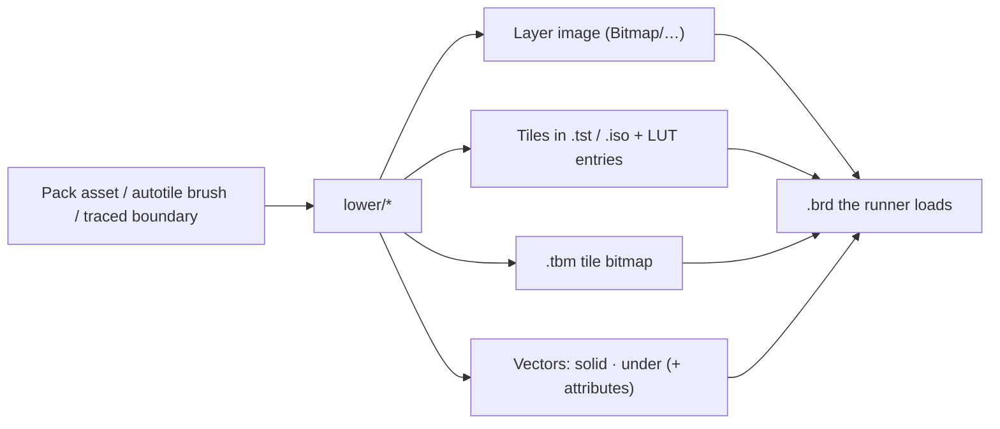
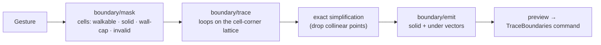

# Tile, asset and board editor: architecture

**Status:** proposed architecture, 2026-11-09. It turns the owner directions recorded in [decisions §4.8](../decisions.md#48-tile-making-not-merely-tile-importing) and the flows in [01 board editor](01-board-editor.md), [03 tiles and art sources](03-tiles-and-art-sources.md) and [10 tile-making without the grind](10-tile-making-without-the-grind.md) into package boundaries, modules and data flow. It sits under the architecture spine: the spine defers "internal structure of each editor tool" to per-epic spines, and this page is the input for those (epic editor-assets-p0 #1358 and epic editor-p1 #1359). Nothing here changes an AD, the spec or a guard-rail.

**Clean-room note (G7).** Built only from `docs/` and this research folder. No legacy source was consulted.

**Formats are the next step.** This page says *what the formats must hold*; the YAML schemas of `.tkrtile` and `.tkrpack` are written separately against this list (§10).

## 1. What we are building

Three things authors asked for, in their own words:

1. **"Make tiles without the grind, and take command of the isometric world."** Slice any sheet; kitbash small edits; draw flat and see it as isometric; build iso blocks and walls from three faces; generate the 47 autotile variants from a base and an edge.
2. **"Pull things from one place and paste them into a scene."** One viewer for tiles, stamps, props, whole-room backdrops and audio. A pasted prop brings its picture, its collision and its walk-behind with it.
3. **"Don't make me trace every wall."** Click the floor and the walls appear. Paint walkable and solid; the polygons follow.

### Owner decisions this design obeys

| Decision | Source | Consequence here |
|---|---|---|
| New native formats use `.tkr<something>` and are YAML | decisions §4.8, §6 Q9 (2026-11-09) | `.tkrtile`, `.tkrpack` (§10) |
| Art packs are editor-only for now | decisions §4.8 (2026-11-09) | `core` gets no new reader; every editor action **lowers** to records `core` already loads (§5) |
| Boards take whole images, not only tiles | board format, layer and background images | Image-first boards are a first-class path (§6.2) |
| Reusable tilesets stay first-class | decisions §4.8 | Packs reference tiles by stable id; boards keep references, not pixel copies |

### Non-goals

- No change to the tick pipeline, `composeBoard`, the draw list or any runtime format reader.
- No automatic art. Generators transform pixels the author supplied; they never invent artwork.
- No legacy write promise beyond what AD-18 and the existing writers already give.

## 2. Layering

The editor packages are planned by epic editor-foundation (#1357) and do not exist yet. This design sits on top of them and respects the spine's edge list (`tools/deps/edges.json`): `core → editor-model → editor-ui → host-*`.

```mermaid
flowchart TB
  subgraph host["host-vscode · host-web · host-desktop"]
    PS["platform-services (AD-20): fs, watch, dialogs, clipboard, document controller"]
  end

  subgraph ui["editor-ui (views; DOM and canvas allowed)"]
    Viewer["Asset & Tileset Viewer"]
    Studio["Tile & Iso Studio"]
    Canvas["Board canvas + outline + inspector"]
    Sandbox["Live sandbox preview"]
  end

  subgraph model["editor-model (DOM-free)"]
    Docs["Documents + command stacks (AD-19)"]
    Index["Asset index + reference graph"]
    Forge["Tile Forge"]
    Boundary["Boundary intelligence"]
    Lower["Lowering: authoring action → board records"]
    Yaml["`.tkrtile` / `.tkrpack` reader-writer"]
  end

  subgraph core["core (unchanged runtime)"]
    Codecs["formats: board, tileset, tile-bitmap, tile-animation, image"]
    Geo["world/coords · raster/shapes · tileset/iso-diamond"]
    Compose["render/composeBoard · raster"]
  end

  PS <--> ui
  ui -- "commands" --> Docs
  Docs --> Forge & Boundary & Lower & Index
  Yaml --> Index
  Forge & Boundary & Lower --> Geo
  Docs --> Codecs
  Sandbox & Canvas -- "same view, same compositor (AD-29)" --> Compose
```

| Rule | Why |
|---|---|
| Pixel synthesis, tracing and lowering live in `editor-model` | They are document edits; they must run where the document lives (in the VS Code extension host under AD-19), with no DOM |
| `editor-model` reaches `core` only through its public entry (AD-22) | Geometry already exported today: `isoSourceOffset`, `isoDestinationPixels`, `isInsideIsoDiamond`, `tileToPixel`, `pixelToTile`, `boardPixelSize`, `stackedToRotated`, `decodeTexture`, the tileset/tile-bitmap/board readers and writers. Anything missing is added to `core`'s entry, not deep-imported |
| `editor-ui` draws every board and tile preview through `composeBoard` and the draw list | AD-29: the editor never owns a second compositor |
| Hosts add nothing | AD-20: file access, dialogs and clipboard only |
| `core` gains nothing at runtime | The editor-only decision. Any feature that *does* need the engine is listed as an engine gap (§11) instead of being smuggled in |

## 3. Module map

| Module (`editor-model/src/…`) | Owns | Pure inputs → outputs |
|---|---|---|
| `documents/tileset-doc` | A tileset or `.tkrtile` being edited: source sheets, slice map, recipes, tile metadata | bytes ⇄ model + residue (AD-18) |
| `documents/pack-doc` | A `.tkrpack`: its assets, anchors, footprints, walk-behind shapes | YAML ⇄ model |
| `documents/board-doc` | A board plus its editor-side links (which placement came from which pack asset) | `.brd` ⇄ model; editor links in a sidecar until a native board format exists |
| `forge/slice` | Grid and diamond slicing, empty-skip, exact-duplicate detection | RGBA + grid → cells |
| `forge/kitbash` | Non-destructive transform stack | cell + ops → cell |
| `forge/iso-project` | Flat → diamond, three-face blocks | faces + height + tints → RGBA |
| `forge/iso-decompose` | Tall iso art → diamond cells or a prop | RGBA + anchor → cells / prop |
| `forge/autotile` | Base + edge → 47 blob variants; neighbour lookup for painting | sources → 47 cells; 8-bit mask → variant |
| `boundary/mask` | Walkable/solid occupancy from tiles, roles, overrides or image alpha | board/image → mask |
| `boundary/trace` | Contour loops from a mask, exact simplification | mask → loops |
| `boundary/emit` | Loops → solid and under vectors with the right open/closed form | loops → `WorldVector[]` |
| `lower/place-asset` | Paste a pack asset onto a board | asset + point + layer → board records |
| `lower/bake` | Tiles → PNG and back | board region → RGBA (through `core/raster`) |
| `index/asset-index` | Every tile, stamp, prop, backdrop and sound in the project; thumbnails; "used in N places" | project files → index + reference graph |
| `commands/*` | One serialisable command per author action | model + args → model' + inverse |

## 4. Documents and commands (AD-19)

Every author action is one named, serialisable command with an inverse; the host owns undo, save, backup and revert.

| Command | Touches | Undo restores |
|---|---|---|
| `SliceSheet` | tileset-doc | previous slice map and tiles |
| `ApplyKitbash` / `EditKitbashStack` | tileset-doc | previous op stack (source pixels are never overwritten) |
| `BuildIsoBlock` | tileset-doc or pack-doc | previous recipe and outputs |
| `GenerateAutotile` | tileset-doc | previous 47 outputs and any overrides |
| `PlaceSceneAsset` | board-doc | the images/tiles **and** the vectors it added, together |
| `TraceBoundaries` | board-doc | the vectors it replaced or added |
| `BoundaryBrush` (paint walkable/solid) | board-doc | previous mask overrides and vectors |
| `BakeLayerToImage` | board-doc (+ a new image file) | board records; the written PNG is left for the host's file history |

**Generated output is derived, sources are kept.** A recipe (slice map, kitbash stack, iso faces, autotile sources) is the document; generated tiles are its output. Regenerating is deterministic (§9), so a recipe change regenerates every output and the diff is reviewable.

**Cross-document edits.** Regenerating a tileset that boards use, or editing a pack asset that boards placed, touches several documents. The spine does not give an atomic project transaction (see [reawakened-fit](../reawakened-fit.md#cross-document-changes-the-real-unresolved-foundation)). Until it does: preview the affected documents, write the source document first, and update dependants as separate undoable commands, each showing what it changes.

## 5. The lowering principle

The editor authors richly; the engine plays what it already understands.



- Lowering is a pure function of the asset, the placement point, the layer and the board's coordinate type. The same inputs give the same records.
- The board document remembers the link (placement → pack asset id) in editor data, so "select all from this asset", "update placements" and "detach" work. The runner never sees the link.
- If a placement cannot be lowered faithfully (an engine gap, §11), the paste preview says so before commit; it never silently degrades.

## 6. The tile and asset side

### 6.1 Tile Forge

**Slice.** Inputs: decoded RGBA (`decodeTexture`, AD-28), cell size, margin X/Y, gap X/Y, projection (square 32, legacy 16, iso diamond 64×32 with optional half-row stagger), transparency mode (alpha, colour key, none). Output: cells in row-major source order with their source rectangle. Empty means fully transparent after the transparency mode is applied; exact duplicates compare decoded RGBA and transparency. Neither skip is silent: the review shows the count.

**Kitbash stack** (from "Tile edits so simple anyone can do them"). An ordered list of ops applied to a source cell or region, each previewable and individually removable: flip H/V, rotate 90/180/270, wrap-scroll (dx, dy), cut corner (diagonal, which half), overlay (another cell or region, offset, opacity), tint (signed RGB, clamped once), palette-ramp swap, greyscale. Sources are never overwritten; the stack is stored in the recipe.

**Flat → iso (top face).** Reuses `core`'s `isoSourceOffset`, the same nearest-neighbour inverse map the runtime uses for `iso2d` blits ([tiles.md](../../../../docs/spec/formats/tiles.md#reawakened-iso2d-projection)), so the studio preview equals what the board shows. An optional **iso polish layer** stores per-pixel overrides on top of the projected diamond, so the flat source stays editable.

**Three-face iso block** (2:1 dimetric). Output image is 64 wide and `32 + H` tall. Every destination pixel is computed by inverse sampling (integer arithmetic only, nearest neighbour):

| Face | Destination region | Source sample |
|---|---|---|
| Top | the 64×32 diamond at y 0…31 | `isoSourceOffset(x, y)` |
| Left (south-west) | `x` 0…31, `y = 16 + floor(x/2) + z`, `z` 0…H−1 | `u = x`, `v = floor(z · 32 / H)` |
| Right (south-east) | `x` 32…63, `y = 31 − floor((x−32)/2) + z`, `z` 0…H−1 | `u = x − 32`, `v = floor(z · 32 / H)` |

Faces are drawn first, the top last. Each face carries a signed RGB tint (defaults top 0, left −24, right −56), applied with the same clamp-once rule as board shading. Each column of a side face receives exactly H pixels, so the map has no holes.

**Tall-iso decomposition.** A tall iso picture (a block, wall, tree or building) is handled one of two ways, chosen in the paste/export preview:

1. **As a prop (default).** One image plus anchor, solid footprint and walk-behind shape; placed as a layer image (§6.3).
2. **As diamond tiles.** The picture is laid on the board's diamond lattice from its anchor cell; every lattice cell whose 64×32 diamond contains opaque pixels becomes an `.iso` tile (mask from `isInsideIsoDiamond`), including the half-diamond wings on the rows in between. Upper cells default to a higher layer, because iso painter order within one layer draws cells north of the anchor *before* it ([board.md](../../../../docs/spec/formats/board.md#drawing-order-and-effects)). The preview shows the result on the board before commit.

**Autotile generator** (Tilesetter-style). Inputs: base, edge (and optionally an inner-corner source and an iso cliff face). Output: the 47 eight-neighbour blob variants, where a corner counts only when both adjacent edges are filled ([editor-features T-25](../../../../docs/editor-features.md)). Generated in square space, then optionally projected to diamonds. Individual variants can be replaced by hand-drawn cells; the override is kept when the sources change. The **stored variant order** for compatibility with community sets is still the spine's open question ("which sample tile sets"); the generator writes a role → cell map, and the legacy order is an export mapping added once that question is answered.

### 6.2 Asset & Tileset Viewer

One dock, many kinds, one index (`index/asset-index`):

| Tab | Shows | Drag onto board does |
|---|---|---|
| Tiles | `.tst` / `.iso` tiles, `.tan` animated tiles | paint |
| Terrains | autotile brushes from `.tkrtile` | paint with neighbour lookup |
| Stamps & props | `.tbm`, pack stamps, cut-out props | `PlaceSceneAsset` |
| Backdrops | whole-room images from packs or `Bitmap/` | set background or add a layer image |
| Audio | `Media/` files | attach (audition beside the row) |

Each entry shows projection (2D / iso), size, badges (`solid`, `walk-behind`, `animated`, `missing source`) and "used in N places" from the reference graph. Right-click: edit in studio, define footprint, find uses, make unique copy. Legacy files appear directly; packs add names, tags and behaviour on top.

### 6.3 Placing assets on a board

`PlaceSceneAsset(asset, point, layer)`:

1. Snap `point` to the asset's anchor rule (tile corner, tile centre, diamond centre, or free).
2. Emit visuals: a layer image at `point − anchor` with its transparency, **or** tile cells (`.tst` / `.iso` references) on the target layer(s).
3. Emit the asset's solid shapes translated by `point`, on `layer`.
4. Emit its walk-behind shapes translated by `point`, as under vectors with their attributes (background 1, lower layers 2, frame intersection 4).
5. Record the editor link. One command; one undo.

On a rotated iso board, cells that fall on invalid corner cells are clipped and listed in the preview ([01 board editor](01-board-editor.md#isometric-boards)).

### 6.4 Image-first boards

A whole PNG can be the board: set it as the background (normal, parallax or stretch) or place it as a layer image, then draw or trace walls and walk-behind over it. **Bake** renders selected layers through `composeBoard` and `core/raster` to a PNG (for painting detail in an external tool) and can re-attach it as a layer image; the tiles it replaced stay in history.

## 7. Boundary intelligence

The legacy start room shows the problem: every wall, bed and table outlined by hand as a separate rectangle, each partition top as another, all edited through a raw vertex table. Boundaries are always polygons in the engine (E-137); the editor's job is to *produce* those polygons from things the author already did.

### 7.1 Author gestures

| Gesture | Result |
|---|---|
| **Click floor → wall the rest.** Pick a floor tile (Shift adds more, e.g. the doorway) | Every connected cell showing one of those tiles is walkable; the boundary of that region becomes solid vectors |
| **Flood from the start marker** | The region reachable from the player start through cells not already marked solid becomes walkable; same output |
| **Boundary brush** (Walkable / Solid) | Paint cells; the affected vectors are re-traced. No vertex list editing |
| **Trace from tile roles** | Tiles tagged `floor`, `wall` or `wall-cap` in a `.tkrtile` (§10) give the mask for the whole board in one command |
| **Magic wand on an image** | On an image-first board, the region of similar colour (tolerance) or non-transparent alpha becomes the mask |

Every gesture previews the vectors it would add, replace or remove before commit. Hand-drawn vectors are never replaced unless the author selects them for replacement.

### 7.2 Pipeline



**Mask.** One cell per stored tile cell of the active layer (for rotated boards, the effective `(sizeX + sizeY)` square; invalid corner cells are `invalid` and treated as solid). Sources combine in a fixed order: tile roles, then auto-solid metadata, then per-cell overrides (Walkable / Force solid) — the same union the board editor already proposes for collision.

**Trace.** Walk the directed edges between walkable and non-walkable cells on the integer cell-corner lattice, keeping walkable on the left, so outer boundaries and holes come out with opposite winding. Ties are explicit (AD-25 style): loops start at their lowest (y, x) corner; at a corner where two walkable cells touch only diagonally the trace always turns the same way (keeps the diagonal cells **separate**, so a wall is never opened through a pinch point). Then delete every vertex that lies on the straight line between its neighbours. On a grid this simplification is exact: the polygon covers the same cells.

**Emit — respecting how the engine tests vectors.** Closed polygons block both entry and containment; open polylines block crossing (E-26). So:

| Loop | Emitted as | Why |
|---|---|---|
| Outer boundary of a walkable region | **open** solid polyline whose last point repeats the first | A closed polygon would *contain* the player and block every step |
| Hole inside a walkable region (furniture, pillar, interior wall block) | **closed** solid polygon | The player must not enter or stand inside it |
| Run of `wall-cap` cells | **closed** under polygon (attributes from the tile role, default 0) | Walk-behind; never solid |

**Coordinates.** Lattice corners become board pixels. Cells are 1-based (board.md); corner `(i, j)` is the corner shared by cells `i` and `i + 1` across, `j` and `j + 1` down, so corner `(0, 0)` is the board's top-left:

| Board | Corner `(i, j)` (between cells) → pixel |
|---|---|
| 2D | `(32·i, 32·j)` |
| Iso rotated | treat the corner as logical point `(i + ½, j + ½)` in the tile formula: `x = (i − j + sizeX)·32`, `y = (i + j + 1 − sizeX)·16 − 16` — always integers, so diamond edges come out on exact 2:1 slopes |
| Iso stacked | convert the mask with `stackedToRotated` (same pixels, same `sizeX`), trace there, project as rotated |

### 7.3 Wall caps and walk-behind

In a top-down room, an interior wall has a solid base and a top that the player should pass *behind* when standing north of it. With tile roles this is automatic: `wall` cells are solid, `wall-cap` cells become under polygons. A **"Generate wall caps"** helper for boards without roles proposes, for each solid run with walkable cells to its north, a cap strip N rows tall (default 1); it is always previewed and is a proposal, not a rule.

On isometric boards the runtime redraws only background spans for under vectors, not promoted tiles ([board.md](../../../../docs/spec/formats/board.md#drawing-order-and-effects)). Wall-cap generation is therefore offered on 2D boards only, and iso walk-behind is an engine gap (§11).

### 7.4 Pixel masks

Image tracing uses the same lattice at pixel resolution, then a Douglas–Peucker pass with an integer tolerance in pixels (default 2) because pixel outlines are not exact. Tolerance and resulting point count are shown in the preview. Stored points stay within the format's limits (point upper bound is a short).

## 8. Previews

| Preview | How |
|---|---|
| Board canvas, studio sandbox, paste ghost | build a `BoardView` and call `composeBoard`; replay the draw list with `render-webgl2` (AD-29, G4) |
| Tile thumbnails, iso block preview | Forge output RGBA blitted as a texture asset in a draw list |
| Export / bake | `core/raster` (AD-4) |

The sandbox is a scratch board document that is never saved unless the author asks.

## 9. Determinism and tests

`editor-model` is not `core`, but its generators produce files people commit and diff, so it follows the same discipline: integer arithmetic for every pixel and coordinate, explicit tie-breaks, no `Math.random`, `Date` or locale APIs. Same recipe → same bytes.

| Test | Proves |
|---|---|
| Forge goldens (hash of output RGBA per recipe) | slice, kitbash, iso faces, autotile are stable |
| Projection parity | studio top-face output equals the runtime `iso2d` blit pixels |
| Tracer cases: single room, room with furniture holes, diagonal pinch, rotated board with invalid corners, stacked board | loops, winding, open/closed choice, pixel coordinates |
| Collision round-trip in the headless harness | a traced room lets the player walk the floor and blocks every wall cell |
| Lowering round-trip | paste → save `.brd` → reload in the runner → same draw list as the canvas |

Per the owner's test-speed rule, every unit test stays under one second; the harness check uses the smallest board that proves the contract.

## 10. What the formats must hold (input to the next step)

**`.tkrtile`** — tile sets and recipes:
- schema id and version; projection; cell size
- source sheets (path, grid: size, margin, gap, stagger, transparency)
- tiles with stable ids, names, tags, optional legacy `(set, index)` provenance
- per-tile **role** (`floor`, `wall`, `wall-cap`, `none`), collision (`walkable`, `solid`, custom shape), terrain
- kitbash stacks; iso blocks (faces, height, tints); polish overrides
- autotile terrains (sources, role → cell map, per-variant overrides)
- animated tiles (frames by stable id, timing)
- output binding: which `.tst` / `.iso` file and slot each generated tile is written to

**`.tkrpack`** — scene assets:
- schema id and version; projection; grid
- named sources (image files, tilesets)
- assets with stable ids, name, category, tags, kind (`stamp`, `prop`, `backdrop`)
- anchor and snap rule
- visuals (image rectangle, or tile cells with tints, with layer offsets)
- solid shapes and walk-behind shapes in anchor-relative pixels, each with open/closed and attributes
- licence and attribution per source

Both are YAML, written by `editor-model` with sorted keys and stable ordering so saves diff cleanly. YAML parsing stays out of `core`.

## 11. Engine gaps found (not solved here)

| Gap | Effect | Options for later |
|---|---|---|
| Tall props on isometric boards cannot y-sort with sprites | images draw after a layer's tiles and before its sprites, so a sprite on the same layer is always in front | place as a board item (heavy); a higher layer (always behind); or a future engine "y-sorted image" — needs an owner decision and a spec change |
| Under-vector tile promotion is 2D-only | iso walk-behind for tiles/images is not available | same as above |
| Multi-floor canopies | a roof covering several floors | see [01 board editor](01-board-editor.md#holes-found-and-fixes) hole 3 |

These keep the "editor-only" decision honest: where the engine cannot show something, the editor says so instead of faking it.

## 12. Epic mapping

| Piece | Epic | Legacy ids |
|---|---|---|
| Asset & Tileset Viewer, asset index, reference graph | editor-assets-p0 (#1358) | T-02, T-24 |
| `PlaceSceneAsset`, image-first boards, bake | editor-assets-p0 | T-26, T-32 |
| Boundary intelligence (trace, brush, wall caps) | editor-assets-p0 (2D); editor-p1 (iso, image tracing) | T-23, T-26, T-34 |
| Tile Forge: slice, kitbash, iso projection, decomposition | editor-p1 (#1359) | T-36, T-37, T-38 |
| Autotile generator and terrain painting | editor-p1 | T-25 |
| `.tkrtile` / `.tkrpack` reader-writer | editor-p1 (format work; schema page first, per G7 docs-first) | — |

All of it waits on editor-foundation (#1357) for `editor-model`, `editor-ui` and platform-services.

## 13. Open questions for the owner

1. **Board-side editor links.** Placement → pack-asset links need storage. Sidecar next to the `.brd` now, or wait for a native board format?
2. **Wall caps without roles.** Is the "Generate wall caps" heuristic wanted at all, or roles only?
3. **Default open-loop form.** Is an open polyline for a room's outer wall acceptable, or should the outer region be emitted as closed polygons around the solid area (more vectors, same behaviour)?
4. **Iso tall props.** Which option in §11, and when?
5. **Autotile variant order.** Still the spine's open question; needed only for legacy-ordered export.

## Sources

- [decisions.md](../decisions.md) §4.8 and §6; [reawakened-fit.md](../reawakened-fit.md).
- Flows [01](01-board-editor.md), [03](03-tiles-and-art-sources.md), [10](10-tile-making-without-the-grind.md).
- `docs/spec/formats/board.md` (coordinates, drawing order, vectors, layer images), `docs/spec/formats/tiles.md` (isometric tiles, iso2d projection, shading).
- `docs/spec/engine/movement-and-collision.md` E-26 (closed vs open vectors), E-137 (boundaries are polygons).
- `docs/editor-features.md` T-02, T-23–T-26, T-32, T-34, T-36–T-39, T-62.
- Architecture spine AD-4, AD-18, AD-19, AD-20, AD-22, AD-25, AD-28, AD-29; `tools/deps/edges.json`.
- Owner references (2026-11-09): RPG Maker blog "Tile Edits So Simple, ANYONE Can Do Them!", tilesetter.org, Pikuma "Isometric Projection in Games" — design inspiration only, no code.
