# Connected Game Workshop

## Brand & Style

A proposed working name for this design, not a product rename. The owner-selected direction is RPG Maker clarity, VS Code workspace flexibility, and direct visual manipulation. This document makes that concrete without selecting a framework, theme, or host. The monochrome tokens above are **wireframe scaffolding**, not approved brand colours.

The product presents a game and the things being made, not a collection of configuration files. Files remain first-class for people who want them. It should be possible to create a tileset, effect, or program without opening a board first.

[EXPERIENCE.md](EXPERIENCE.md) owns behaviour; this document owns presentation. These proposal spines take precedence over the illustrative [wireframe atlas](wireframes.html); neither overrides normative repository specs or owner decisions.

## Colors

Use neutral framing so game art dominates. Selection, dirty state, warnings, shared scope and disabled capabilities carry text or shape as well as colour. The final theme should adapt to the host's light, dark and high-contrast themes; this atlas does not select one. Production contrast requires measurement in each actual host/theme, not inference from these wireframes.

## Typography

Plain labels before specialised terminology: **Moves**, **Effects**, **When spoken to**, **Used by**. Keep RPGCode and file paths in monospace, not entire inspectors. Allow text scaling; a long asset name wraps or expands rather than disappearing behind an icon. Put units beside numeric controls and distinguish configured values from observed test results.

## Layout & Spacing

The stable grammar is **find → make → inspect → try**, not a required sequence:

- Left: named Game, Files, Assets and search views. Game and Files can coexist; neither is a separate project.
- Centre: tabbed documents. Visual canvases, record forms, code and comparisons are peers.
- Right: selection inspector or focused related record, with explicit scope and return destination.
- Bottom: optional preview, timeline, diagnostics or test results. It opens for a task, not permanently by default.
- Top: current project, named command/search entry, save status and explicit test entry choices.

Use one visible task toolbar for the active editor rather than one toolbar for every feature. The board has labelled overlay controls and separate visibility/locking/runtime enablement. Hiding an overlay never alters the game.

Proposed desktop proportions: a roughly 220px navigator, flexible centre, roughly 280px inspector. They are starting measurements, not minimum product requirements. Closing the inspector gives space back to the canvas. Narrow-host layouts stack or reveal one region at a time with named navigation; they do not shrink fields to unreadability. Preserve DOM/focus order when the layout changes.

The atlas is a reading document, not a docking prototype: below 900px its regions stack. This proves legibility of the proposal, not production small-screen editing fitness.

## Elevation & Depth

Persistent neighbours use borders, not floating windows. A focused visit stays beside its origin when there is room. Full-editor promotion opens a document view of the same working record; a repeated click does not create another independent unsaved copy. Reserve modal decisions for destructive/conflicting choices, not ordinary asset browsing.

## Shapes

Small corner radii and visible separators express work areas. No decorative card around every field. Use grouping headings and space to communicate ownership before adding borders.

## Components

| Component | Visual contract |
|---|---|
| Document header | Name, record/file kind, dirty/saved state, ownership/scope, reachable save action |
| Context trail | Origin task plus named return link; a relationship path is not a claim about storage nesting |
| Scope banner | “Shared definition · used by …” versus a supported local instance; never offer imaginary local overrides |
| Inspector | Selection name, grouped properties, labelled advanced sections, direct related-record links |
| Collection view | Searchable list and detail; explicit Compare selection for multi-record work |
| Dependency review | Changed record, known uses, unresolved/dynamic uses, before/after consequences |
| Test strip | Mode, fixture/entry, source revision and unsaved-state policy; no generic Play ambiguity |
| Settings row | Label/help, value, effective source, override/reset affordance; schema metadata informs both forms and JSON |
| Recovery notice | What failed, what remains safe, what action preserves work; never a false “Saved” badge |
| Tool availability | Missing provider/capability explanation beside preserved data; not an empty panel |

## Do's and Don'ts

- Do show **Open full editor**, **Return to Venom Bite**, **Find uses**, and **Preview** in words.
- Do distinguish a preview image, a calculated estimate and a run of the game.
- Do let people pin side views, compare records and restore a layout without resetting documents.
- Do keep the simplest default useful without customising panels or installing extensions.
- Don't copy VS Code's icon density or RPG Maker's database wholesale.
- Don't make a universal property grid the only interface for pixels, movement, timing or relationships.
- Don't treat wireframe controls, illustrative values or example test results as functioning runtime features.

## Visual coverage

The atlas has ten concrete compositions: workspace, board, artwork, animation, database, effects, events/code, settings, delivery/recovery, appearance/audio. Each shows a different authoring problem inside the same layout grammar. Character/item/enemy/move variations, cursor details, import steps, plugin-loss states and specialist recovery states are specified in EXPERIENCE.md rather than individually mocked. Flow coverage identifies those variants; the proposal is not a pixel-complete screen inventory.

## Annotated Board-Workbench Mock & Shared Editor Design System (#2703)

The shared editor workbench (`packages/editor-ui` and `packages/editor-model`) implements a unified IDE layout inspired by Figma, VS Code, and the classic RPG Toolkit 3 workbench, keeping project navigation, the active document tab strip, editing tools, the central canvas stage, and the contextual inspector/palette simultaneously visible at desktop sizes while collapsing cleanly at narrow viewports.

```
┌────────────────────────────────────────────────────────────────────────────────────────────────────────────────┐
│ [ ☰ ] 🗡️ RPG Toolkit editor [Files] [Game] [Tileset] [Run]   [ Search files & run commands… Ctrl+Shift+P ]     │
├──────────────────────┬───────────────────────────────────────────────────────────────┬─────────────────────────┤
│ [Left Dock: 240px]   │ [Tab Strip: 34px]  [example.gam ×] [village.brd • ×]          │ [Right Inspector: 280px]│
│ ▾ Files (Tree)       ├───────────────────────────────────────────────────────────────┤ ▾ TILESET BROWSER       │
│   ▸ Bitmap           │ [Board Header]  Board · 16 × 12 cells, 2 layers   [Save] ✓    │   Source                │
│   ▸ Boards           ├───────────────────────────────────────────────────────────────┤   [detail.tst (tst)  ▾] │
│     • village.brd    │ [Toolstrip] [Draw*][Select][Flood fill][Erase][Rect][Dropper] │   ┌─────────┬─────────┐ │
│   ▸ Chrs             │             [Undo][Redo] [Zoom out] 200% [Zoom in] [Grid*]    │   │ [Tile1] │ [Tile2] │ │
│                      │             Layer [1 ▾]                                       │   │  #1 *   │  #2     │ │
│──────────────────────├───────────────────────────────────────────────────────────────┤   │ [Brush] │ [Brush] │ │
│ ▾ GAME (Accordion)   │ [Visible Layers] [ ] Layer 1  [x] Layer 2 – ground  [Show all]│   └─────────┴─────────┘ │
│   ▾ BOARDS (1)       ├───────────────────────────────────────────────────────────────┤                         │
│     • village.brd    │         ┌───────────────────────────────────────────┐         │                         │
│   ▾ CHARACTERS (1)   │         │                                           │         │                         │
│     • ada.tem        │         │          BOARD CANVAS STAGE               │         │                         │
│   ▾ ITEMS (1)        │         │      (Checkerboard + Crisp Pixel Art)     │         │                         │
│     • chest.itm      │         │                                           │         │                         │
│   ▾ ENEMIES (1)      │         └───────────────────────────────────────────┘         │                         │
│     • slime.ene      ├───────────────────────────────────────────────────────────────┤                         │
│   ▾ SPECIAL MOVES (1)│ [Active Cell & Matrix]  Col 1, Row 1: [detail.tst1] [Paint]   │                         │
│     • fireball.spc   │   [1,1*] [2,1] [3,1] ... (compact keyboard-navigable grid)    │                         │
└──────────────────────┴───────────────────────────────────────────────────────────────┴─────────────────────────┘
```

### Generalized Workbench Infrastructure (`@tk-reawakened/editor-model` & `@tk-reawakened/editor-ui`)

1. **Unified Top Workbench Bar (`38px`)**:
   - **Application Menu (`☰`)**: VS Code-style categorized cascade menu (`File`, `Edit`, `Selection`, `View`, `Go`, `Run`, `Help`) housing all document and project lifecycle actions (`New Board…`, `Open Project Folder…`, `Reopen Recent Project`, `Save All Open Documents`, `Save Active Document As…`, `Revert Active Document`, `Close Active Tab`, `Undo`, `Redo`, `Toggle Second View`, panel toggles, and playtest actions).
   - **TKR Sword Brand Mark & Panel Toggles**: Displays the TKR sword emblem (`media/icons/png/tkr-32.png`) beside `RPG Toolkit editor` and quick-toggle pills (`Files`, `Game`, `Tileset`, `Run`).
   - **Command Palette (`Ctrl+Shift+P` / `Cmd+Shift+P` / `F1`)**: Filterable modal dialog searching both registered `CommandRegistry` commands (`createWorkbenchCommands`) and project files (`Go to File`).
2. **Stacked Left Explorer Dock (`.tkr-dock-left`)**:
   - Stacks the `Files` tree above the collapsible `Game` (`▾ GAME`) categorized accordion (`Boards`, `Characters`, `Items`, `Enemies`, `Special moves`, `Status effects`, `Battle backgrounds`, `Animations`), with both enabled by default (`DEFAULT_WORKBENCH_PANELS`).
   - **Empty Explorer View (`EmptyExplorerView` / `mountEmptyExplorer`)**: When no project folder or `.gam` is open yet, the left explorer dock renders `EXPLORER` → `▾ No Game Opened` with `Open project folder`, `Open .gam session copy`, and `Reopen project` actions while the central stage displays the centered TKR sword hero emblem (`media/icons/png/tkr-128.png`).
3. **Persistent Right Inspector (`TilesetBrowser`)**:
   - Remains docked in `.tkr-dock-right` across active tabs by default so tilesets and tile bitmaps stay inspectable while switching documents.

### Shared CSS Custom Properties (`--tkr-*` with `--vscode-*` & `light-dark()` Fallbacks)

| Token | Role | VS Code Bridge | Browser Default (`light-dark()`) |
|---|---|---|---|
| `--tkr-bg-app` | Outer workbench & chrome | `var(--vscode-sideBar-background)` | `light-dark(#f3f4f6, #18181b)` |
| `--tkr-bg-panel` | Docked panels & inspector cards | `var(--vscode-editorWidget-background)` | `light-dark(#f8fafc, #1e1e22)` |
| `--tkr-bg-surface` | Document surface | `var(--vscode-editor-background)` | `light-dark(#ffffff, #141417)` |
| `--tkr-bg-stage` | Artwork / board canvas stage | `var(--vscode-editor-background)` | `light-dark(#e2e8f0, #0c0c0e)` |
| `--tkr-bg-control` | Buttons, inputs, selects | `var(--vscode-input-background)` | `light-dark(#ffffff, #27272a)` |
| `--tkr-fg-primary` | Primary labels & values | `var(--vscode-foreground)` | `light-dark(#18181b, #e4e4e7)` |
| `--tkr-fg-muted` | Secondary captions & units | `var(--vscode-descriptionForeground)` | `light-dark(#52525b, #a1a1aa)` |
| `--tkr-border-subtle` | Panel & card dividers (`1px`) | `var(--vscode-panel-border)` | `light-dark(#e4e4e7, #2e2e36)` |
| `--tkr-accent` | Active tool, selected cell, primary CTA | `var(--vscode-focusBorder)` | `light-dark(#2563eb, #3b82f6)` |
| `--tkr-dirty` | Unsaved edit badge (`•`) | `var(--vscode-gitDecoration-modifiedResourceForeground)` | `light-dark(#d97706, #f59e0b)` |
| `--tkr-danger` | Refusal / conflict / invalid state | `var(--vscode-errorForeground)` | `light-dark(#dc2626, #f87171)` |

### Control & State Matrix

| State | Visual Contract |
|---|---|
| **Keyboard Focus (`:focus-visible`)** | `2px solid var(--tkr-focus-ring)` with `outline-offset: 2px` (`-2px` inside dense grid cells). |
| **Selected / Pressed (`[aria-pressed="true"]`, `[aria-selected="true"]`)** | Tinted accent surface (`--tkr-accent-subtle`), `1px solid var(--tkr-accent)` border, semibold label (`font-weight: 600`). |
| **Disabled (`:disabled`, `[aria-disabled="true"]`)** | `opacity: 0.48`, `cursor: not-allowed`, muted border; hatched cell pattern for off-board isometric cells. |
| **Unsaved Edits (Dirty)** | Amber dot (`•`) in tab strip + status pill (`Unsaved changes`) next to enabled primary `Save` button. |
| **Errors & Conflicts (`[role="alert"]`, `[aria-invalid="true"]`)** | Danger border (`--tkr-danger`), tinted alert banner (`--tkr-danger-subtle`), and parent `<fieldset>:has([aria-invalid="true"])` highlight. |
| **Forced Colors (`@media (forced-colors: active)`)** | System keywords (`Canvas`, `CanvasText`, `Highlight`, `HighlightText`, `GrayText`, `ButtonBorder`) preserve all state distinctions without relying on background fills. |

### Rendered Workbench Captures (`evidence/`)

#### 1. Browser Host Workbench (`tools/browser/editor-web/index.html`)

- **Board Workbench (Dark IDE Mode, 1440×900)** — Unified top bar with `☰` menu, TKR sword icon, stacked `Files` + `Game` left dock, central checkerboard board stage, and right `TilesetBrowser` inspector:
  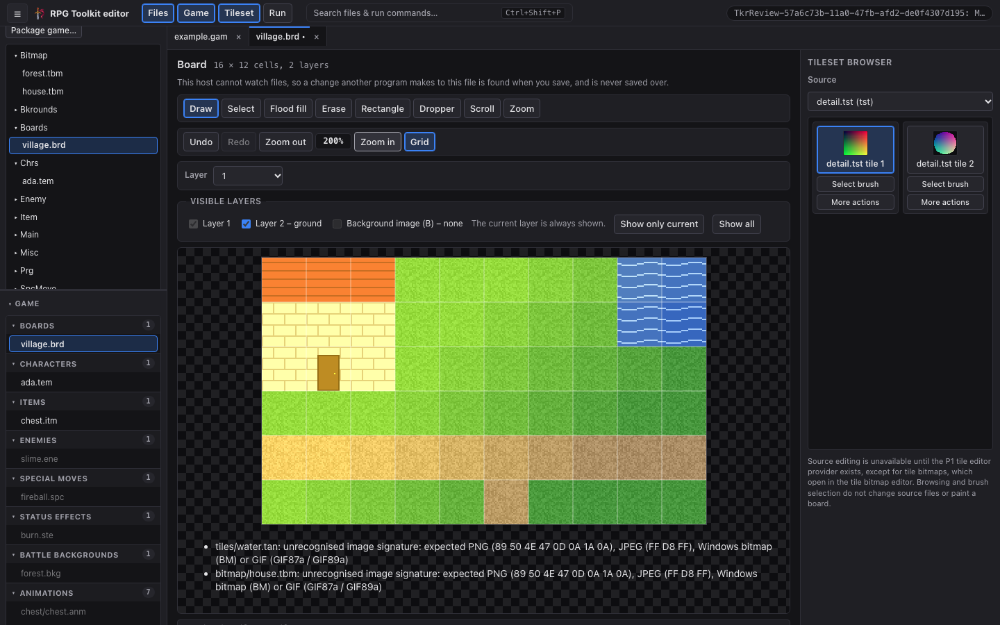
- **No Game Opened (Empty Explorer Dock & Hero Stage, 1440×900)** — Left Explorer empty state (`▾ No Game Opened`) and centered TKR sword emblem on the stage:
  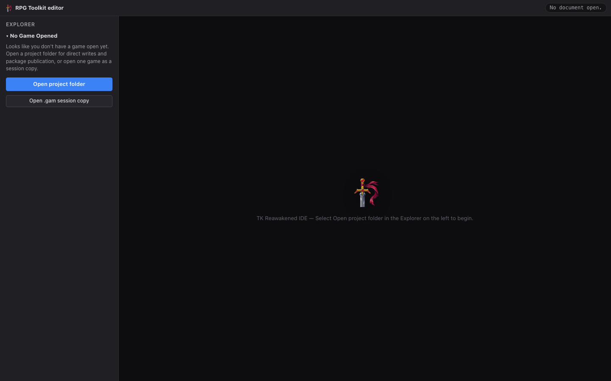
- **Application Menu (`☰` File / Edit / Selection / View / Go / Run / Help)**:
  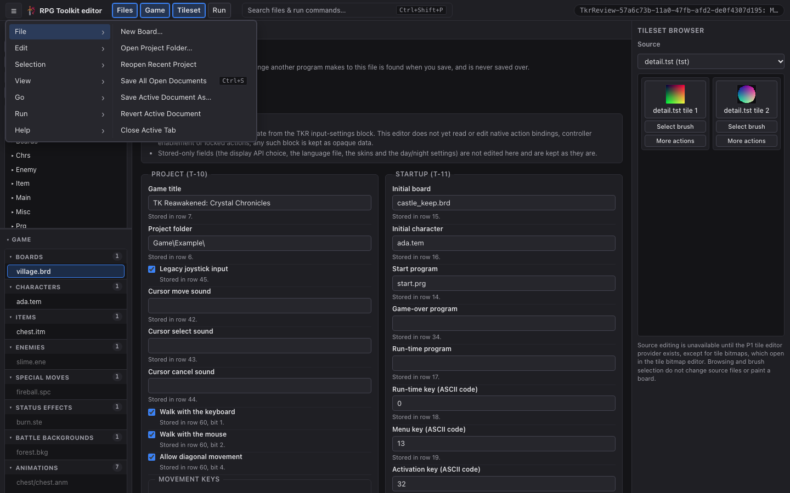
- **Command Palette (`Ctrl+Shift+P` / `F1` — Commands & Go to File)**:
  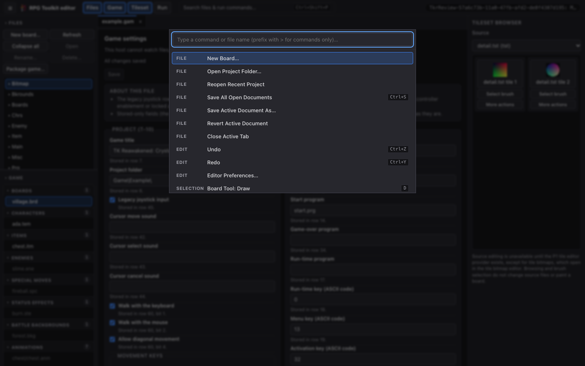
- **Board Workbench (Light IDE Mode, 1440×900)**:
  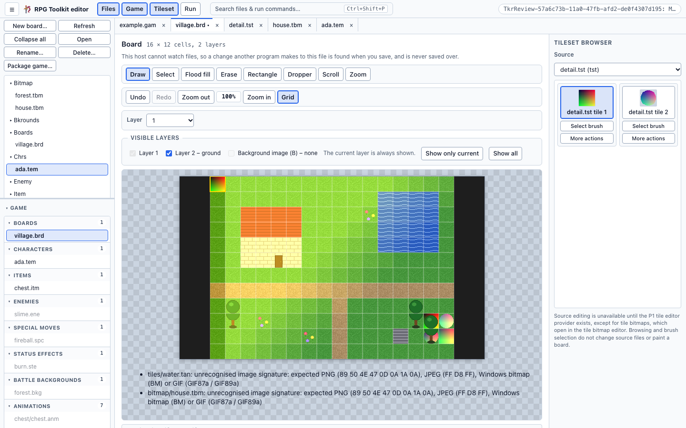
- **Tileset Artwork Editor (Dark IDE Mode, 1440×900)**:
  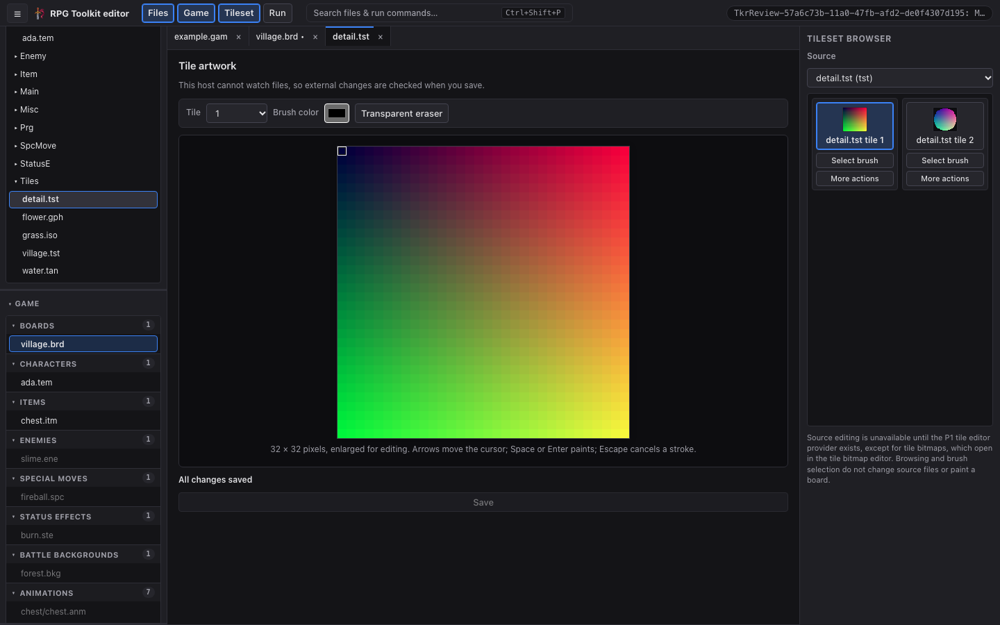
- **Tile Bitmap Editor (2-Column Workspace & Palette, 1440×900)**:
  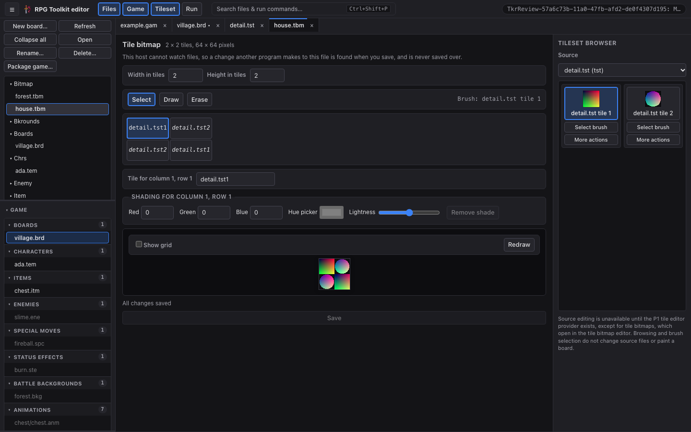
- **Character & Sprite Authoring Workspace (1440×900)**:
  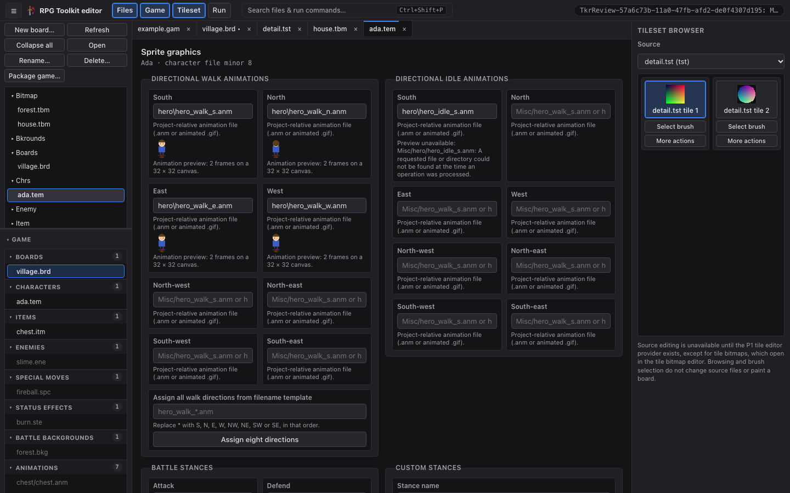
- **Game Settings Editor (2-Column Responsive Fieldset Cards, 1440×900)**:
  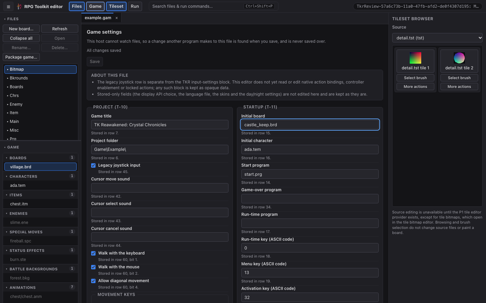
- **Narrow Responsive Viewport (`680×900` `@container` Collapse)**:
  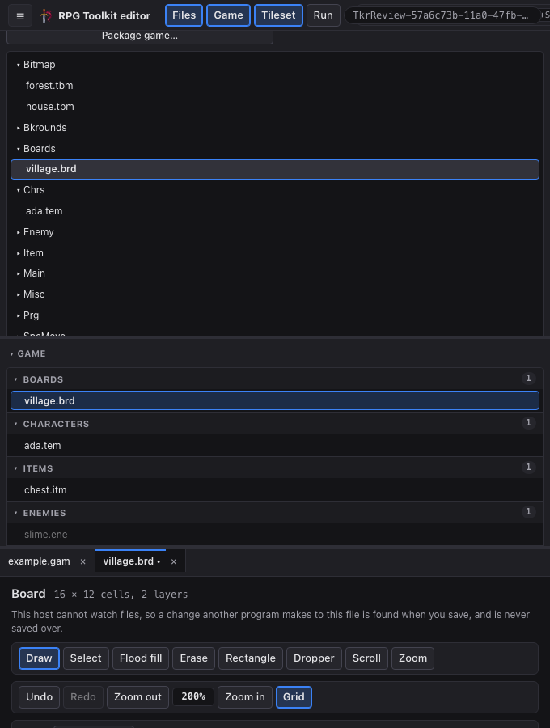

#### 2. VS Code for the Web Host (`@vscode/test-web` — `extensions/editor`)

- **VS Code Board Custom Editor**:
  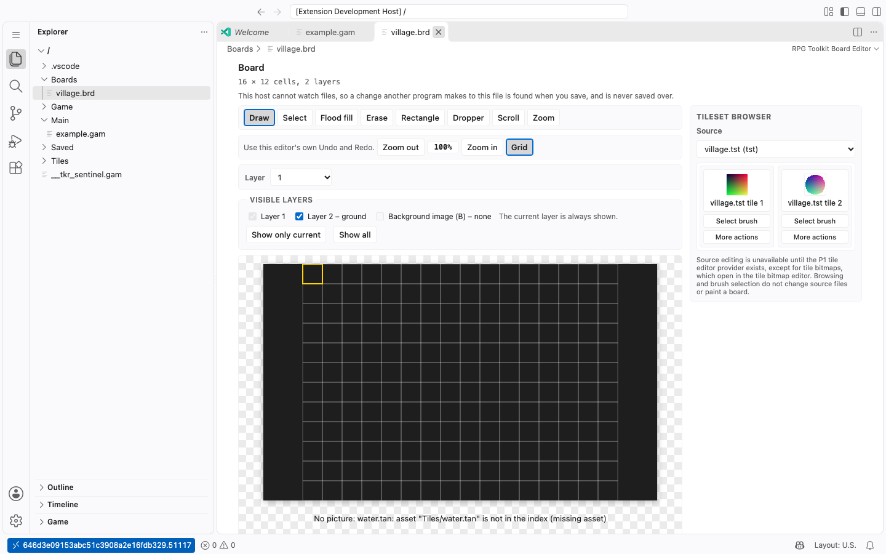
- **VS Code Tileset Artwork Custom Editor**:
  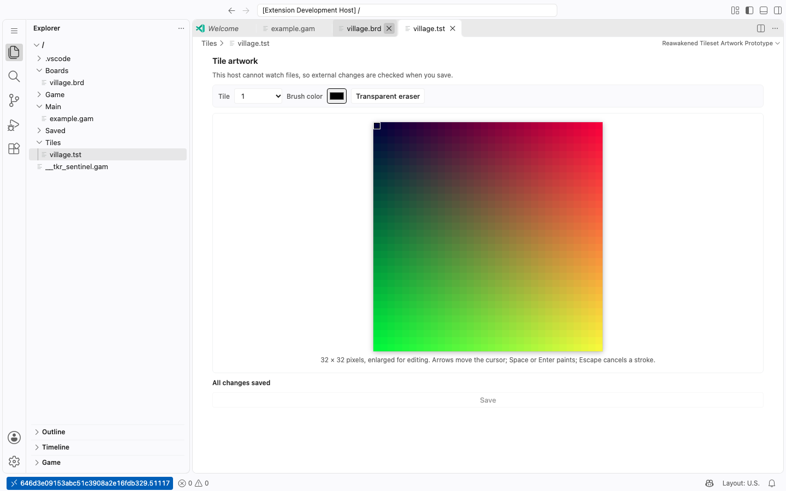
- **VS Code Game Settings Custom Editor & Explorer Game View**:
  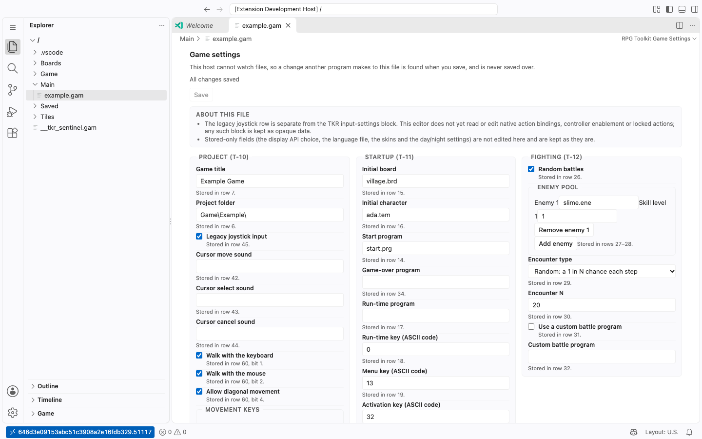
