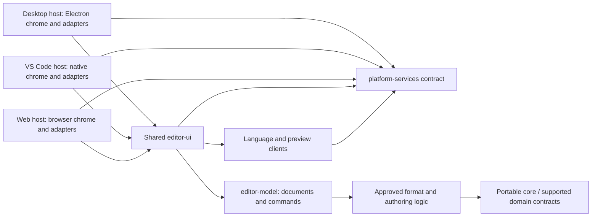
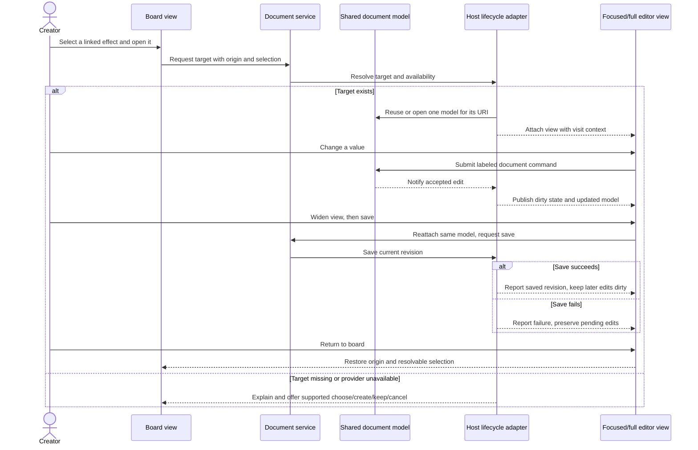

# Connected editors: host-independent architecture proposal

**Status: proposal for discussion and prototyping, not an ADR, specification, implementation audit, or delivery claim.** The goal is one game-making experience with approachable tasks, direct visual editing, and a flexible workspace—not an IDE that creators must configure before making a game. Game and Files are different views of the same project, available separately or together. [Workspace](wireframes.html#workspace), [board](wireframes.html#board), [effects](wireframes.html#effects), and [settings](wireframes.html#settings) illustrate proposed surfaces, not working software.

**Authority matters:** [G2](../../../docs/guardrails.md#g2--hard-package-boundaries) and the existing architecture remain binding. [ADR 0013](../../../docs/adr/0013-desktop-shell-electron.md) selects Electron for the desktop editor and player, and [ADR 0021](../../../docs/adr/0021-monaco-code-editor.md) selects Monaco for standalone/browser code editing. Dock Spawn, layout, Monaco's version and this integration design remain open. VS Code retains native text editing; the supported extension and web hosts and shared platform-service boundaries remain. These decisions are not evidence that any component has shipped.

## The proposed shape

The same board, artwork, animation, database, effects, event, appearance, settings, and delivery interactions belong in shared `editor-ui`. Their domain editing logic and document history belong in the host-independent model. The shell supplies navigation and window chrome, adapts host services, and presents native capabilities; it does not grow a second implementation of each editor. A direct visual action and an accessible keyboard/form action invoke the same document operation.

The diagram shows **conceptual dependency direction**, not a claimed package graph or invented public API. Arrow A → B means A depends on B. Host adapters provide the implementation of the service boundary at composition time; the reverse dependency is not an import. Exact package placement and existing allowed edges must be checked against the architecture's dependency graph before implementation.

G2 requires `editor-ui` to access the host only through platform services, never by importing `vscode`, Electron, or host packages; every editor feature lands in shared UI first. The core is host-independent and performs no I/O. This sketch adds no permission to bypass the checked dependency edges. AD-19/20 describe one document per URI per host, DOM-free model and serializable edit commands, host-owned save timing and undo coordination, and host capability reporting. Their named interfaces are existing *architectural contracts*, not an assertion of a live API.

### Host responsibilities

| Concern | Desktop workbench candidate | VS Code extension candidate | Shared or conditional |
|---|---|---|---|
| Navigation | Game and Files views, tabs, palette, optional docks in host chrome | Native explorer/contributed Game view and native editor tabs | Both navigate to the same document identities; separate or combined views are presentation, not storage. |
| Script | Use the selected Monaco editor for code; integrate language services deliberately | Native text editors and language integration | Same language semantics and diagnostics; Monaco alone is not VS Code's workbench, extension host, LSP wiring, or recovery system. Native text/document synchronization needs proof. |
| Visual work | Shared editor views in desktop panels | Shared visual views in custom-editor webviews; extension host owns models | Same editor features and document operations, not a complete standalone workbench embedded in a webview. Exact webview placement and size are open. |
| Workspace | Candidate dock manager manages groups, layout and focus | Native VS Code editor groups and contributed views | Save document independently of panel layout. Per-host layout and shortcuts may differ. |
| Services | Desktop adapters for files, project, dialogs, execution, export, settings and document lifecycle | Extension adapters map those requests to available VS Code APIs | Platform services expose actual availability and errors; neither host silently pretends an unavailable service exists. |

The [artwork](wireframes.html#artwork), [animation](wireframes.html#animation), [database](wireframes.html#database), [events](wireframes.html#events), [appearance](wireframes.html#appearance), and [delivery](wireframes.html#delivery) views are different clients of this shared system, not separate document stores. A browser host remains an intended architectural consumer; the two-host prototype below does not claim browser parity.

## Authored documents, session context, and running games

- **Authored project data** is the creator's game: boards, programs, assets, game settings, battle definitions and provider-owned data. It uses the applicable supported format and explicit document/reference ownership. The proposal does not require a new format, database, stable identifier scheme, or block round-trip.
- **Editor preferences** control the authoring experience, such as an editor grid display or preferred panel arrangement. They are not game rules. Editor layout, selection, zoom, current task, return target and uncommitted dialog inputs are session/view state unless a supported document explicitly owns them.
- **Runtime state** belongs to a running preview/test and its runner, not to the authoring document or settings catalogue. A fixture, when supported, supplies explicit test inputs; any persisted fixture has its own documented owner. Running a test does not silently change authored data.
- **Generated and imported material** retains source/derived distinctions where supported. A visual preview does not bake or overwrite the source. Import/conversion requires an explicit reviewed operation; unknown provider data must be preserved, not guessed.

A project navigator may index the same document through Game and Files. The index is a view; it is not a second authoritative copy. Reference lookup should distinguish known links from uncertain dynamic script references, and show missing targets without silently creating a replacement. The identity rules, rename handling and reference completeness remain open; an index cannot claim a safe project-wide rename when its evidence is incomplete.

## Document and task lifecycle

AD-19 supplies the governing design: one document model per URI per host, command-based edits, host-coordinated undo/redo and dirty state, and host-driven save, save-as, revert, backup and external-change handling. VS Code's model is held in the extension host; webviews hold view state. The following is a proposed interaction protocol within that boundary, not a new API declaration:

1. Open a URI via either navigator; reuse the host's existing document instance. Focused inspector, broad workspace, split views and reopened webviews attach to that same model rather than creating editable clones.
2. A view submits a labeled, serializable edit to the document owner. On acceptance, all views observe the resulting document state; the host records the edit notification for undo/redo and derives dirty state. A rejected edit leaves the model unchanged and explains why. Undo routes back through the owner—not an independent canvas or host byte buffer.
3. Promote focused work into a full editor by opening another view of the **same** model. Carry origin task, selected subject, edit scope, pending operation and return destination as visit context. Return restores the originating selection when still resolvable; otherwise explain what moved or disappeared. Closing a view must not discard the document or its undo stack merely because a dock/webview is hidden.
4. Distinguish draft control state from a committed document command: cancel a dialog before commit without an edit; undo a committed edit through the document history. Scope is explicit: changing a shared asset affects its uses; a unique/local edit is offered only when the data model and operation support it.
5. Save captures the intended revision, writes through the host, and marks clean only when that revision is durably reported saved; later edits remain dirty. Save failure leaves pending changes visible. Save As must resolve the destination, identity and reference consequences before proceeding; collision, cancellation and partial failures cannot be reported as success. Atomicity, backup guarantees and cross-document transactions are not assumed.
6. For an external change, detect/report when the host can, preserve local dirty work and the external version, and offer appropriate compare, keep local, reload or manual reconciliation. Do not silently overwrite either. Revert/close confirms potential loss; recovery is offered only where the host actually has a usable backup. Rename/delete reviews known and uncertain references.
7. A proposed Play action saves relevant edits first and stops with the failing document named if save fails. Current-board test uses an explicit test point; Play from start is separate. Run only when the selected host, assets and provider support it. A preview or trace reports its actual inputs and does not promise determinism or coverage beyond the available fixture and runner.

A linked edit can touch more than one authored document. Until a cross-document transaction/undo contract is established, present each pending change and save/failure separately; do not claim all-or-nothing rollback. A missing link offers choose, explicit create, keep unresolved, or cancel when available; merely navigating to a missing reference does not create anything.

The sequence is illustrative behavior, not an implemented call sequence. For the connected effect → move → enemy task, each target may be a different document and follows its own save and undo lifecycle; the origin context is not a transaction.

## Settings catalogue and host adapters

A **proposed shared declarative catalogue**, inspired by VS Code's [`contributes.configuration`](https://code.visualstudio.com/api/references/contribution-points#contributes.configuration), describes stable IDs, value types, defaults, labels/descriptions, groups, validation constraints, and intended scopes. It can drive a searchable settings UI and generate or map a compatible subset of VS Code contribution metadata. JSON Schema alone does not encode all VS Code contribution metadata or scope behavior. Host-specific metadata, value mappings and unsupported combinations must be explicit; catalogue reuse is a hypothesis until tested, not a drop-in compatibility promise.

| Operation | Proposed shared behavior | Host adapter / unresolved details |
|---|---|---|
| Read | Display effective value, its winning source, any override, and default. | Resolve host-supported scopes and notify the UI of external changes. Prove semantics for each target rather than assuming a uniform hierarchy. |
| Change | Validate type/constraints, explain invalid input, choose an explicit allowed target scope, and report success or failure. | Map that scope and value to the host configuration system; do not silently write a different scope. |
| Reset | Remove the override **at the chosen scope**, then recompute and show the inherited effective value; this may not equal the default. | Confirm removal/change notifications and unsupported or read-only scopes in both hosts. |
| UI and text | UI and text are two routes to the same preferences; invalid text reports location and preserves the last valid effective configuration. | Which host owns editing, comment preservation, storage and conflict behavior must be proven. |

**Open policy, not selected precedence:** candidate layers are catalogue default, user, workspace/project and resource override, ordered from broader to more specific *where each is supported and permitted*. Decide the actual allowed layers, precedence, VS Code scope mapping including language/remote/workspace-folder cases, reset target, portability and behavior on restricted hosts before implementing. JSON versus JSONC for standalone storage is undecided; if comments are supported, the text editor and writer must preserve them. Storage paths, migration/versioning, invalid value handling and extension-contributed catalogue collision rules also require decisions. Preferences remain usable without network or AI.

Game inputs, cursor, movement, startup and battle behavior are **authored game data**, even when presented in a Settings screen ([F-01](../research-editor-ux-for-beginners/engagement-user-flows.md#f-01--find-and-safely-change-project-input-cursor-startup-and-movement-settings-sc-33)). Their controls may reuse form widgets or schemas but must edit the owning game document, participate in its history and travel with the project; they are not relocated to machine or workspace preference storage. See [settings](wireframes.html#settings).

## Plugins and unavailable capabilities

The [plugin-editor study](../research-editor-ux-for-beginners/flows/09-plugin-editors.md) suggests three *unapproved* contribution shapes: command descriptions, declarative fields, and specialist panels. They are design options, not an existing plugin-editor API. Shared hand-designed database UI need not become plugin-owned. A contribution would need explicit ownership/versioning, validation, document operations, reference behavior, host support, migration and preview contracts; a preview through the selected battle system must not silently substitute stock rules. Disabled or missing providers leave unknown data preserved and inspectable; editing known fields is allowed only when unknown data can be preserved. No native legacy DLL support is implied.

Existing plugin direction is a single ungated in-process contract, not a new trusted/untrusted tier or manifest permission list. Host boundaries and content security policy still apply; a webview or iframe is not proof that plugin code is sandboxed. Loading extension code is a trust and distribution risk, not made safe by a declarative-looking manifest. Provider discovery, activation, custom UI transport, lifecycle, compatibility and migrations are unresolved; contributions must not write around document ownership or bypass G2.

**Proposed capability presentation**, not a claim any row is implemented:

| Creator action | Prerequisite to check | If unavailable |
|---|---|---|
| Open/save a project or use an external editor | Host file access, write/watch support, permissions and provider | Explain the actual limit; keep work dirty; offer supported download/reimport rather than pretend live synchronization. |
| Edit visually in a webview | Registered editor/provider, supported webview and message bridge | Preserve data; offer text/inspection where safe or explain why editing is blocked. |
| Run battle/board/program fixture | Runner, required assets, selected provider and fixture/trace support | Disable the specific action with the reason; never switch battle systems silently. |
| Export or share | Exporter and destination; network service only for hosted sharing | Offer a supported local output, or explain why unavailable; partial output is not success. |
| Compare/recover external edits | Host watch and access to original, local and external versions; actual backup | Preserve local work and report missing comparison/recovery option; no invented backup. |
| Plugin specialist panel | Provider version, host UI/transport and CSP compatibility | Keep unknown data; identify the missing provider/host support and any safe read-only route. |

Platform capabilities are availability facts for graceful degradation, **not plugin security grants**. Permissions denied, provider missing, unsupported host, offline state and ordinary failures should be distinguishable where adapters can determine them.

## Electron boundary and docking lifetime

For the desktop host, use the secure `app://` scheme and no service worker as specified by ADR 0013. The proposed renderer has no direct Node integration; enable context isolation and sandboxing where compatible, and expose a narrow, typed preload/IPC bridge to explicit host operations. Validate sender, operation and arguments in the privileged process; do not expose generic filesystem, shell, arbitrary IPC or unrestricted URL opening to page content. Use a restrictive CSP and controlled navigation/external-link handling, protect user-selected paths and avoid exposing secrets. Treat imported projects and asset content as untrusted data. These precautions protect the Electron renderer boundary; they do not change the accepted ungated application-plugin trust model or prove a plugin sandbox.

Dock Spawn is only a candidate. Before adoption assess current maintenance, complete dependency and bundled-license inventory against G6, accessibility, keyboard navigation, resize behavior, persistence, view reparenting and unmount behavior. A dock holds a **view handle**, not the authoritative document, history or unsaved edits. Closing, moving, hiding and restoring a panel must dispose/reconnect listeners safely, preserve or reconstruct view state and keep the document alive according to host lifecycle. If a canvas cannot survive reparenting, remount it from model plus view state; do not assume preservation. Native VS Code groups/webviews need the equivalent hide/reveal/dispose proof. Layout persistence is per host, not game data.

## Prototype proof, not a roadmap

Use the same project snapshot, authored assets, task instructions and expected outcomes in **both** the Electron workbench candidate and the VS Code extension candidate. Paper flow IDs refer to [the research rehearsals](../research-editor-ux-for-beginners/engagement-user-flows.md), not completed tests. This order is for learning, not feature priority. Record exact versions, host/API capabilities, missing pieces, task completion, wrong turns, context loss, explicit failures and recovery—not just screenshots or elapsed time. Exercise keyboard-only and offline/no-assistant routes; use real creator sessions before claiming usability.

| Proof task | What each host must demonstrate | Evidence and discriminating failure |
|---|---|---|
| F-02/F-11, board and code split | Open a board event, follow its program to code, edit, undo/redo, widen and return with origin/selection; close and reopen a view. | Command and dirty-state trace; same URI/model identity, exact source preservation, host save/reopen. Check native text synchronization and unsupported block fragments; do not claim block round-trip. |
| F-09, effect → move → enemy | Open an existing linked effect, change it, follow move to enemy, inspect scope and return; test with a named fixture only if the selected system supports it. | Per-document changes, save results and reference diagnostics; compare provider and fixture actually used. Missing link/provider must stay visible and data preserved. |
| F-04, shared art and conflict | Open tile from a board in focus, promote to artwork view, label shared scope, then modify source externally while local work is dirty. | Observe both versions retained, comparison choices, failed/cancelled save and return context; do not assume local uniqueness or complete reference search. |
| F-01 and preference rehearsal | Find an authoring preference, change through UI and text, show source/effective scope, reject invalid value and reset the chosen override; separately change an authored game input. | Capture equivalent effective values where scopes map; record mapping gaps and JSON/JSONC behavior. Verify game data saves with its document, not the preference store. |
| F-12/F-13, missing provider and handoff | Open data with provider absent; inspect safe preservation, cancel migration, and attempt local project/export handoff with a deliberately unavailable capability. | Compare preserved bytes/data where possible, surface reason and actual destination; no silent fallback, fabricated preview or success on partial export. |
| Workspace lifecycle | Move, resize, hide/reveal, close/reopen and restore dock/group with dirty work and multiple views. | Observe one model per URI, working undo/redo, selection/focus, no duplicated listeners or lost edits; compare native VS Code group behavior to candidate dock manager. |

AD-19 calls for a host-conformance suite: prototype it against both adapters for open/reopen, edit, undo/redo, dirty tracking, save failure and later edits, external change, revert, backup availability, and view disposal. Include a realistic malformed/missing reference, unavailable provider, conflict and cancelled action. Exercise security settings, sender validation and CSP in a packaged desktop build; inspect Dock Spawn licensing and keyboard behavior before selecting it. No prototype result is asserted here.

## Decisions still needed and evidence to collect

1. **Workbench integration and docking:** How should the selected Monaco editor be versioned and integrated, and does Dock Spawn meet G6, accessibility, lifecycle and maintenance needs? Evaluate docking alternatives with packaged-host evidence. Electron is already selected by ADR 0013.
2. **Document identity and references:** How are URIs normalized, save-as/rename handled, unknown/dynamic links indexed, external conflicts reconciled, and multiple open views synchronized? Demonstrate on real supported formats; do not infer a new format or atomic cross-document undo.
3. **Native text vs visual document ownership:** How do VS Code native text editors and custom editors share authoritative source, commands and undo without dual ownership? Verify the relevant current VS Code APIs with a working split-view prototype.
4. **Task and view lifetime:** Which origin/selection state survives promotion, nested navigation, hiding, reparenting, restart and missing targets? Observe both hosts and accessible workflows.
5. **Settings policy:** Decide allowed scopes, precedence, reset, storage, JSON vs JSONC, invalid values and migration; establish exactly which catalogue metadata maps to VS Code and how extensions contribute. Compare effective-value traces in both hosts.
6. **Plugin authoring:** Which contribution levels are needed, who owns data and migrations, how are specialist panels hosted under G2/CSP, and what can run on each host? Prototype stock and deliberately different providers; preserve missing/unknown data. No new trust tier is selected.
7. **Run, fixtures, delivery and recovery:** Which host/provider supports each operation, what exactly can be recovered or rolled back, and what is the save-before-test boundary? Demonstrate explicit failures and recipient-side artifact checks; avoid promising unsupported guarantees.

Any change to an existing binding rule requires the project's normal decision process. Nothing in this page grants an exception or changes the current records.

## Key source files

- [Research decisions §§8–9](../research-editor-ux-for-beginners/decisions.md#8-engagement-area-direction--2026-11-07): owner direction, candidates and open decisions, not new architecture.
- [Engagement flows F-01–F-13](../research-editor-ux-for-beginners/engagement-user-flows.md) and [design prompt](../research-editor-ux-for-beginners/engagement-design-prompt.md): task scenarios, host comparisons and evidence limits; paper rehearsals, not observed outcomes.
- [Flow index](../research-editor-ux-for-beginners/README.md): all ten editor studies and the distinction between research and implementation.
- [Plugin editor research](../research-editor-ux-for-beginners/flows/09-plugin-editors.md): proposed contribution shapes and provider gaps, not an adopted plugin API.
- [Guardrails](../../../docs/guardrails.md) and [architecture spine, AD-19/20](../architecture-rpgtoolkit-reawakened/architecture-rpgtoolkit-reawakened.md#ad-19--documents-one-model-per-file-the-host-owns-undo-and-save-timing): binding boundaries and planned document/service contracts, not implementation verification.
- [ADR 0001](../../../docs/adr/0001-typescript-core.md) and [ADR 0013](../../../docs/adr/0013-desktop-shell-electron.md): shared host direction and the accepted Electron desktop decision; neither selects this workbench layout or docking library.
- [Format specification index](../../../docs/spec/README.md): authority for supported authored formats; does not approve new editor storage formats.
