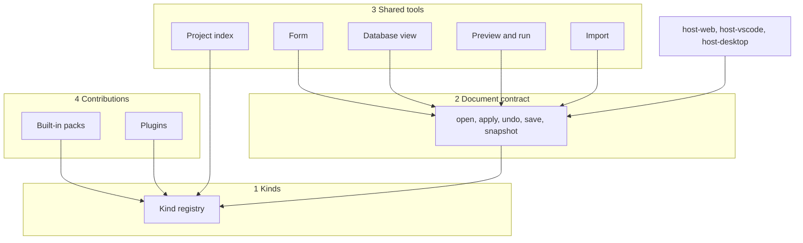

# The proposed architecture

Part of the [editor ecosystem proposal](README.md). **Proposed.** The type sketches are illustrations of shape, not an API. Each real shape is fixed by the first story that calls it, the way `platform-services` fixes its surfaces ([current state](current-state.md#what-is-built)).

## In plain terms

Picture the editor as four layers.

* At the bottom, **kinds**: a table that says what documents exist and how each is recognised.
* On that, **one document contract**: open, edit, undo, save, the same for every kind.
* On that, **shared tools**: a form, a Database view, an index of the project, pickers, problems, preview, import.
* On top, **contributions**: the built-in editors and plugins both add to the three layers below through the same descriptions.

A host sees only the second layer. A plugin sees only the fourth. An editor author writes a view against a contract and does not care which file the data came from.



An arrow from A to B means A depends on B.

## Layer 1: kinds

A **kind** is described by plain data. This is the whole of what the rest of the editor needs to know about it:

```ts
// Illustration only.
interface KindDescription {
  id: string;                 // "board", "scene", "animation-clip.legacy", "com.example.weather/forecast"
  contract: string;           // the logical shape it carries, e.g. "animation-clip"
  label: string;              // "Animation"
  description: string;        // one plain sentence for a game author, then the technical one
  area: string;               // where it appears in the Game view: "World", "Art", "Database", ...
  extensions: string[];       // [".anm"] or [".tkranm"]
  storage: StorageClass;      // see below
  schema?: SchemaRef;         // the fields, for the form, validation and pickers
  references?: ReferenceRule[]; // which fields point at which contracts
  buildsFrom?: string;        // for a build output: the kind it is lowered from
}
```

Rules for the registry:

1. **One registry, in two halves.** The data above and the model factory live in `editor-model` (no DOM). The views for a kind live in `editor-ui`. Both halves are keyed by the kind's `id`.
2. **A legacy file type is a kind.** `.brd`, `.gam`, `.tem` and the rest register exactly as a native kind does. No code path asks "is this legacy?"; it asks for the kind's storage class.
3. **Recognition follows the records already written.** A native kind is recognised by its registered extension *and* its stamp, which must agree ([native-contracts.md](../spec/formats/native-contracts.md#file-names), rule 4). A legacy kind is recognised by extension and header, as the format readers do today. The native extension table in `packages/native-data` stays the single source for native extensions; the kind registry reads it and does not copy it.
4. **Hosts are generated from it.** VS Code's `customEditors` entries, file associations (T-82), the `.gitattributes` lines and the "new document" menu come from the registry at build time, the way ADR 0022 D6.4 generates `contributes.configuration` from the settings catalogue. No host lists kinds by hand.
5. **Help text is not optional.** A kind's `description`, and every field label in its schema, follow the owner's help-text rule: first what it does for someone making a game, then the exact technical behaviour.

### Storage classes

The storage class decides who is the authority for the content. It is ADR 0022 D2's table, given names.

| Storage class | Examples | Authority | Edited through | Notes |
|---|---|---|---|---|
| **Legacy binary** | `.gam`, `.brd`, `.tem`, `.itm`, `.ene`, `.anm`, `.tbm`, `.tst` | `editor-model`: bytes plus a command stack | Commands | Read-write only with a same-version writer (D2.1); otherwise read-only with the reason |
| **Program text** | `.prg`, `*.spec.prg` | The host's text document in VS Code; an `editor-model` text document elsewhere | Text edits | A visual view submits text changes and keeps no second model (D2.3) |
| **Native text** | `.tkranm`, and later scene, actor and other `.tkr*` documents | As program text (D2, native row) | Text edits made by structured commands | Closed core fields, open plugin blocks, both preserved on write (ADR 0023 decision 12) |
| **Outside asset** | PNG, JPEG, GIF, BMP, WAV, MIDI, fonts | The file | A viewer; an art or audio tool where one exists; an outside application | Referenced by other documents; may be the source of an [import](#import) |
| **Build output** | A `.brd` built from a `.tkrscn` | The kind it is built from | Not editable | An outside edit is found by hash and offered as an import, never overwritten (ADR 0019 decision 4) |

### One contract, more than one kind

ADR 0009 says Toolkit 3 shapes are adapters onto our model. In the editor that becomes a concrete rule: **a view is written against a contract, and a kind is an adapter from a file to that contract.**

The animation editor is the first case. Its view edits the `animation-clip` contract. Two kinds carry it: the legacy `.anm` (binary, commands on a format model) and the native `.tkranm` (text). The same frame strip, preview and inspector work on both. A field the legacy file cannot store is shown as unavailable with the reason and one offered action, *convert to the native document*. That conversion is an explicit, reviewed operation that makes a new document with a new identity (D1.3). It never happens on open.

This is a goal with a test, not a universal claim. ADR 0023 decision 9 redefines the item, NPC and enemy family into contracts that do not match the legacy files one to one. For such a family the legacy kind keeps a legacy-shaped view for the first release, and the mapping is ruled on the contract's own page. Each contract page states which of the two applies.

## Layer 2: the document contract

Every kind's model implements one small interface. It is what `MainDocument` already is, with the main file's types taken out:

```ts
// Illustration only. Compare packages/editor-model/src/main-document.ts.
interface EditorDocument<Snapshot, Command> {
  readonly identity: DocumentIdentity;      // ADR 0022 D1
  readonly readOnly: ReadOnlyReason | null; // D2.1
  snapshot(): Snapshot;                     // plain data for views
  apply(command: Command): ApplyResult;     // accepted whole or rejected with a reason (D3.1)
  undo(editId: string): HistoryResult;      // binary documents (AD-19); text follows the host
  redo(editId: string): HistoryResult;
  save(): Promise<SaveResult>;              // clean only when durably written (D3.3)
}
```

Two things follow.

**Hosts implement the lifecycle once.** A host adapter drives `EditorDocument`, not `MainDocument`. A new kind then works in every host on the day it is registered.

**A kind-conformance suite sits beside the host-conformance suite.** Story 11.3 proves each *host* keeps ADR 0022 D3. The same idea proves each *kind*:

| Check | Rule it proves |
|---|---|
| Open, save with no edit, and the bytes are identical | AD-18 |
| A rejected command leaves the snapshot unchanged and names its reason | D3.1 |
| Apply, undo, and the snapshot equals the one before | AD-19 |
| Apply, save, reopen, and the snapshot equals the one saved | D3.3 |
| Data the kind does not model is still there after an edit elsewhere and a save | AD-18 residue; ADR 0023 decision 12 |
| A file with no same-version writer opens read-only with a reason | D2.1 |
| Every command has a label fit for an undo menu | AD-19 |

The suite is a table of kinds run through one set of tests. Under the owner's test-speed rule each case uses the smallest authored fixture for its kind and no engine.

## Layer 3: shared tools

Each tool is built once and works on any kind that supplies what it needs. Each is built by the first story that needs it ([roadmap](roadmap.md)).

### The form

A form is generated from a kind's schema: field types, ranges, defaults, labels, units, grouping, and which fields are references. It uses a **fixed set of controls**, the one the [plugin-editor study](../../_bmad-output/initiative-rpgtoolkit-reawakened/research-editor-ux-for-beginners/flows/09-plugin-editors.md) lists: number with units, choice in plain words, yes or no with its consequence, asset picker with a thumbnail, list of rows, sentence list, curve, compass, colour, key capture, script slot and preview panel.

* Every edit the form makes is a command on the document. The form holds no state of its own beyond the field being typed.
* A hand-designed editor stays hand-designed. The form is the default any kind gets for free and the inspector beside a canvas; it does not replace the character editor's layout.
* The settings view of 11.5 and this form are the same machinery pointed at two different stores. ADR 0022 D6.1 still holds: game data is edited in its document, preferences in the settings layers.

### The Database view

One list-and-detail screen over **all documents of a kind**: a searchable list on the left, the kind's form or its hand-designed editor on the right. Characters, items, enemies, moves and status effects are kinds shown this way, and so is any kind a plugin adds. The list is the project's files of that kind, so there are no numbered slots and no maximum to change. Comparison across rows and bulk edits are later additions to the same view.

### The project index

One DOM-free index in `editor-model`, built from the registry and the open project:

* every document, by kind and by contract;
* every **known** reference between documents, from each kind's `references` rules and from plugin blocks whose schema marks a reference (ADR 0024);
* every **uncertain** reference, from RPGCode strings, supplied by the one RPGCode symbol index and never rebuilt here;
* problems: the native checker's findings and each kind's validation, in one list.

It answers "what uses this?", "what is missing?" and "what would this rename touch?" for the reference review of ADR 0022 D1.3. It is a view of the project, never a second copy of it, and it is rebuilt from the files.

### Pickers

A reference field asks for a **contract**, not an extension. "Choose an animation" lists every document whose kind carries `animation-clip`, legacy and native together, with previews, and offers *create new* and *bring in a file* (T-05). The picker reads the index.

### Preview and run

A kind may supply a **preview**: a small fixture and a way to hand the document to the real engine through `runner-harness`. The engine produces a draw list and the editor replays it (G4). An animation preview, a battle-screen preview and a board test are the same service with different fixtures. The four launches of ADR 0022 D8 are unchanged.

Because the engine is deterministic and writes an input log (AD-14), three tools become cheap that the rival editors do not have in this form. They are listed as opportunities, not commitments:

* **Replay.** A recorded play session reproduces exactly. A bug report can be a file.
* **Step back.** Re-run the log to an earlier tick and inspect state there.
* **Record a test.** Turn a recorded session into a creator-test fixture and action list (14.7).

### Import

Bringing in a file from another tool is an explicit operation with three parts:

1. A **source** kept as given (a Tiled map, an LDtk level, an Aseprite sheet, a sprite sheet, a sound).
2. A **recipe**: the settings chosen at import, such as tile size, transparent colour, which layers to bring, or how frames are cut. The recipe is saved, so the import can be reviewed and run again.
3. **Results**: ordinary project documents. Each records its source's name and hash in its `metadata`, so the editor can say "the source changed; import again?" The standard `metadata` keys are an open item of [native-contracts.md](../spec/formats/native-contracts.md#not-decided-here), and this is their first caller.

The tile grabber (T-37) and the animation wizard (T-61) are already imports of this shape, and ADR 0019's tile recipes are already saved recipes. The proposal is to treat them as one mechanism. Multi-file results follow ADR 0022 D4.2 and are recorded as one checkpoint group (D12).

An editor importer is not an engine decoder. AD-31's `AssetDecoder` lets the *engine* read a format at run time. An importer makes project documents at authoring time and the engine never sees the source. A format may have one, the other, or both.

## Layer 4: contributions

Everything above is registered by a **contribution**: a plain-data description of kinds, schemas, field descriptions, commands, importers, templates, previews and settings, plus optional view code. The built-in editors register through it first. Plugins come later through the same shape. The detail, the three levels and the open trust questions are on [extensions.md](extensions.md).

## Where each part lives

No new package and no new edge in the dependency list (AD-22) is proposed.

| Part | Package | Why |
|---|---|---|
| Kind descriptions, model factories, the document contract, the project index, lowering, import recipes | `editor-model` | DOM-free; imports `core` for the format readers and writers and `platform-services` types (G2) |
| Native contracts, checker, native extension table | `native-data` | As today |
| Views, the form, its controls, the Database view, pickers, canvases | `editor-ui` | Reaches the host only through `platform-services` (G2) |
| Lifecycle adapters, chrome, generated manifests | `host-*` | Platform services and chrome only |
| Readers and writers of legacy formats; the engine | `core` | Unchanged. No YAML, no DOM, no new reader without its own ADR |
| The host door | `platform-services` | Unchanged by this proposal. Whether loading a plugin's contribution needs a new surface is [open](extensions.md#open-questions) |

## Guard-rail check

| Guard-rail | Effect |
|---|---|
| G1, G3 | None. No VM or core change. Editor code that must be repeatable (lowering, canonical writes) uses integer data and fixed key order, as ADR 0019 already requires. |
| G2 | Kept. The table above adds no edge. A view written against a contract imports no host and no file format. |
| G4 | Kept, and relied on: every preview replays an engine draw list. |
| G5 | Goldens are untouched. The runner's inputs do not change. |
| G6 | Each importer for an outside format needs a library or our own reader, and each library passes the licence gate before the story starts. |
| G7 | New kinds are our own designs, written in `docs/spec/` first. Legacy kinds are implemented from `docs/spec/` as now. |
